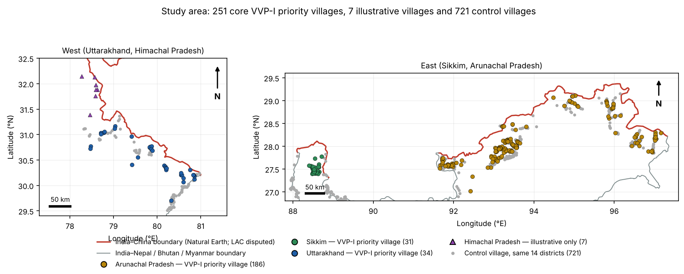
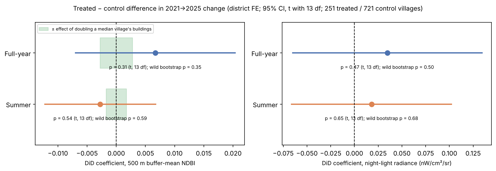

# BORDER OPTICS
### Satellite evidence on India's Vibrant Villages Programme (VVP-I)

Executive Summary · DOI: 10.5281/zenodo.21759970 · Sakshi D. Maske · Version 2.0 (October 2026)

## The question

India's Vibrant Villages Programme (VVP-I), approved in February 2023 with an outlay of about ₹4,800 crore, targets 2,967 villages on the northern border, 662 of them designated priority villages. In February 2026 the Ministry of Home Affairs told Parliament that "no impact assessment has been carried out" (Lok Sabha Unstarred Question No. 508).

**This study asks: did VVP-I priority villages show more satellite-observed built-up and night-light change between 2021 and 2025 than non-priority villages in the same districts?** It also asks how much change the satellite measures could actually detect, and whether change is concentrated near the international boundary.

## Data and method

- **Villages.** 251 priority villages geocoded in Arunachal Pradesh (186), Sikkim (31) and Uttarakhand (34), plus 721 comparison villages from OpenStreetMap in the same 14 districts. Seven Himachal Pradesh villages are shown as illustrations only; Ladakh has no public village list.
- **Satellite measures,** each averaged over a 500 m buffer around the village, for 2021 and 2025, in full-year and June–September composites (Google Earth Engine):
  - Sentinel-2 NDBI (built-up index)
  - VIIRS night lights
  - Sentinel-1 radar backscatter
  - Dynamic World built-up probability
  - Google Open Buildings footprints, used for validation
- **Design.** A difference-in-differences comparison of priority and comparison villages with district fixed effects. Inference suited to 14 district clusters: t with 13 degrees of freedom and an exact wild cluster bootstrap. Checks: a 2019–2021 placebo, leave-one-district-out, randomization inference and sample-quality sensitivity.
- **Detectability.** For each measure, how much it moves per square metre of building, estimated from the footprint data, and therefore what change it could have detected.

## Findings

1. **Built-up index, night lights and radar: no difference** between priority and comparison villages in either window (all p ≥ 0.31; Table below).
2. **That null cannot rule out construction.** Buildings cover a median 0.33% of a 500 m buffer. Doubling a typical village's buildings would move buffer-mean NDBI by about 0.002, only 13–14% of the smallest effect the design can detect. The NDBI result is uninformative, not evidence that nothing was built.
3. **Dynamic World, the measure most sensitive to buildings, shows a small positive difference in both windows.** It is equivalent to roughly 800–2,100 m² of built-up surface per priority village and passes the small-cluster bootstrap (p = 0.041 full year, 0.008 summer). The summer result survives every check; the full-year result depends on Sikkim. A 2019–2021 placebo is clean, so it is not an earlier trend continuing.
4. **No consistent border-proximity pattern.** Pooled correlations between change and border distance reflect differences between districts. Within districts they disappear (built-up index) or reverse (night lights grew more in villages *farther* from the border).
5. **Budget and outcome are unrelated** across the three states (descriptive, n = 3).

| Outcome | Full year: difference (p) | Summer: difference (p) |
|---|---|---|
| NDBI (built-up index) | +0.0067 (0.31) | −0.0028 (0.54) |
| Night lights | +0.035 (0.47) | +0.018 (0.65) |
| Sentinel-1 VV / VH | +0.006 / −0.004 (0.83 / 0.89) | +0.019 / +0.000 (0.52 / 1.00) |
| Dynamic World built probability | **+0.0026 (0.031; bootstrap 0.041)** | **+0.0059 (0.004; bootstrap 0.008)** |

*NDBI and night-light differences with 95% intervals. The green band shows the change that doubling a typical village's buildings would produce; the intervals are several times wider.*

## What it means

On the measures this study set out to use, there is no detectable programme effect by 2025. Those measures, however, are too coarse to register village-scale construction, so the evidence does not show that nothing happened. The only building-sensitive measure points to a small positive effect. It may be early programme construction, related works such as roads or the state's model-village schemes, or a classifier artefact, and this study cannot yet tell which. Two years after launch is also early for physical works to appear.

For anyone evaluating public programmes from space, the transferable lesson is to estimate what an outcome *could* detect before reporting a null result. Here, that single calculation changes how the main result should be read.

## Limitations

- Treatment is priority *designation*; completed works are not observed. Comparison villages may include non-priority VVP-I villages.
- 251 of 552 listed villages were geocoded, unevenly across districts, and positions are not yet verified against imagery: 35 buffers contain no mapped building, 7 pairs share coordinates, and Kibithoo (where VVP was launched) could not be located.
- Full-year composites include snow; 2023 composites may be unmasked; VIIRS pixels are about the buffer's size.
- 14 district clusters; administrative, not random, selection.

## Next steps (prepared, need Earth Engine)

1. Outcomes measured inside each village's building footprint zone, Dynamic World built-up area in m², and a 2026 follow-up.
2. Same-day re-extraction of the full-year data.
3. Geocode review against high-resolution imagery.
4. Works-completion data for a subset of villages.

## How this result was reached

Earlier versions reported effects that disappeared once data problems were fixed:
- an incomplete Sikkim extraction
- comparison villages that duplicated priority villages
- a snow error in a cloud mask

Version 2.0 followed an independent review. It moved the primary analysis to the difference-in-differences, added the detectability and within-district analyses, corrected the attribution of the Anjaw case villages, and added sample-quality checks. Every change is recorded in `BO_Development_Log.md` and summarised in `BO_Results_Stability_Table.md`.

---

GitHub: github.com/sakshimaske303-commits/BORDER_OPTICS | Live Dashboard: borderoptics-bkx3lpcvfghdpa2hmuqwsg.streamlit.app | Zenodo DOI: 10.5281/zenodo.21759970

Sakshi D. Maske — Independent Geospatial Researcher
