# Did India's Vibrant Villages Programme Change Its Border Villages? A Multi-Sensor Difference-in-Differences Assessment, 2021–2025

**Sakshi D. Maske**
Independent Geospatial Researcher

Version 2.0 (October 2026). Earlier versions and the full record of changes are listed in Section 9.

## Abstract

India's Vibrant Villages Programme (VVP-I), approved in February 2023 with an outlay of about ₹4,800 crore, targets 2,967 villages on the northern border, 662 of them designated priority villages. In February 2026 the Ministry of Home Affairs told Parliament that no impact assessment had been carried out. This study asks whether priority villages show more satellite-observed physical change between 2021 and 2025 than non-priority villages in the same districts. We geocoded 251 priority villages in Arunachal Pradesh, Sikkim and Uttarakhand and selected 721 comparison villages from OpenStreetMap in the same 14 districts. For each village we extracted Sentinel-2 NDBI, VIIRS night lights, Sentinel-1 backscatter and Dynamic World built-up probability within a 500 m buffer, under full-year and June–September composites, and estimated district fixed-effects difference-in-differences models with district-clustered inference (t with 13 degrees of freedom and an exact wild cluster bootstrap). NDBI, night lights and radar show no treated–control difference (all p ≥ 0.31). Dynamic World shows a small positive difference in both windows (p = 0.031 and 0.004; bootstrap p = 0.041 and 0.008), equivalent to roughly 800–2,100 m² of built-up surface per village; the summer estimate is robust to every check, while the full-year estimate depends on Sikkim. A detectability analysis shows why the indices disagree: buildings cover a median 0.33% of a 500 m buffer, so doubling a village's buildings would move buffer-mean NDBI by about 0.002, a seventh of the smallest effect the NDBI design can detect. The NDBI null is therefore uninformative rather than evidence of no change. A pooled association between change and border distance disappears or reverses within districts. Settlement-footprint outcomes and a 2026 follow-up are prepared as the next step.

**Keywords:** Vibrant Villages Programme; policy evaluation; Earth observation; difference-in-differences; Sentinel-2; Sentinel-1; VIIRS; Dynamic World; Google Open Buildings; detectability; border regions; India.

---

## 1. Introduction

Large public programmes in remote regions are hard to evaluate on the ground, and India's Vibrant Villages Programme (VVP-I) is a clear case. Approved by the Union Cabinet in February 2023, it funds roads, power, communications, tourism and livelihood works in 2,967 villages across 46 blocks and 19 districts of Arunachal Pradesh, Sikkim, Uttarakhand, Himachal Pradesh and Ladakh, with 662 villages designated as priority villages for the first phase (Ministry of Home Affairs, 2023a, 2023b). Asked in the Lok Sabha whether the programme's impact had been assessed, the Ministry replied that "no impact assessment has been carried out" (Ministry of Home Affairs, 2026).

Satellite data offer an independent view of such places, and they have been used to evaluate infrastructure and rural development programmes elsewhere. They also carry a risk that is easy to overlook: an index averaged over an area much larger than the change of interest can miss real change entirely, and a null result from such an index can be mistaken for evidence that nothing happened. This study treats that risk as part of the question.

**Research question.** *Did VVP-I priority villages show more satellite-observed built-up and night-light change between 2021 and 2025 than non-priority villages in the same districts?*

Two subsidiary questions follow from it:

- **SQ1 (measurement).** How large a change could each satellite measure, as implemented, actually detect?
- **SQ2 (pattern, descriptive).** Is change related to distance from the international boundary, as a securitization reading of the programme would suggest (Buzan, Wæver, & de Wilde, 1998)?

The study makes three contributions. It provides the first independent satellite assessment of VVP-I. It combines four sensors and products (optical index, night lights, radar, machine-learned land cover) with a ground-truth building dataset in a single difference-in-differences design. And it quantifies, in physical units, what a buffer-averaged remote-sensing outcome can and cannot detect, a check that is rarely reported but decides how a null result should be read.

## 2. Background

### 2.1 The programme

VVP-I's state-wise sanctioned works total about ₹3,431 crore. Of this, ₹2,749.74 crore (2,082 works) is in Arunachal Pradesh, ₹270.58 crore (200 works) in Uttarakhand, ₹188.90 crore (63 works) in Sikkim, ₹126.01 crore in Himachal Pradesh and ₹95.76 crore in Ladakh, against the approved outlay of about ₹4,800 crore. Village-wise priority lists are public for Arunachal Pradesh and Sikkim (Ministry of Home Affairs, 2023a). For Uttarakhand, official sources give block and district counts only, and the 51 names used here come from a secondary list whose 14/27/10 district split matches the official counts. Himachal Pradesh (75 priority villages) and Ladakh (35) have no published name-level lists. The programme was formally launched at Kibithoo, Arunachal Pradesh, in April 2023, so physical works in priority villages could have begun only after that date (Outlook India, 2023).

### 2.2 Measuring settlement change from space

The Normalized Difference Built-up Index, NDBI = (SWIR1 − NIR)/(SWIR1 + NIR), is a standard spectral proxy for built-up surface (Zha, Gao, & Ni, 2003), but it also responds to bare soil, rock and snow. VIIRS Day/Night Band radiance tracks electrification and activity (Elvidge et al., 2017) at a resolution of roughly 500–750 m. Sentinel-1 C-band backscatter responds to built structures independently of clouds. Google's Dynamic World provides a per-pixel probability of the "built" class from a deep-learning model applied to Sentinel-2 (Brown et al., 2022), and Google Open Buildings provides building footprints from high-resolution imagery (Sirko et al., 2021). These measures differ in what they see, at what resolution, and how much non-settlement surface enters a buffer average, which is why this study uses all of them.

## 3. Data

### 3.1 Villages

| Source | Use |
|---|---|
| Arunachal Pradesh identified-villages list; Rajya Sabha Q. 2321 (2023) annexure | Priority villages, Arunachal Pradesh and Sikkim |
| Secondary list matched to Uttarakhand Rural Development Department counts | Priority villages, Uttarakhand |
| OpenStreetMap Nominatim; ISRO Bhuvan village geocoder | Village coordinates |
| OpenStreetMap Overpass (place = village / hamlet) | Comparison villages |
| Natural Earth 1:10m Admin-0 boundary lines | Distance to boundary (cartographic, not authoritative) |
| Google Open Buildings v3 | Building footprints (validation, detectability) |

Of 559 listed priority villages in the four states, 258 were geocoded and district-verified (Table 1). The core sample is the 251 villages in Arunachal Pradesh (186 of 455), Sikkim (31 of 46) and Uttarakhand (34 of 51); the 7 Himachal Pradesh villages are shown only as illustrations. Figure 1 maps the sample.

**Table 1.** Sample.

| | Arunachal Pradesh | Sikkim | Uttarakhand | Total core |
|---|---|---|---|---|
| Listed priority villages | 455 | 46 | 51 | 552 |
| Geocoded (core sample) | 186 | 31 | 34 | 251 |
| Districts in sample | 10 | 1 | 3 | 14 |
| Comparison villages | — | — | — | 721 |

*The 14 districts are the clusters for all inference (Arunachal Pradesh: Anjaw, Dibang Valley, East Kameng, Kra Daadi, Kurung Kumey, Lower Dibang, Tawang, Upper Siang, Upper Subansiri, West Kameng; Sikkim: North; Uttarakhand: Chamoli, Pithoragarh, Uttarkashi).*

**Figure 1.** Study area. Core priority villages by state, illustrative Himachal Pradesh villages (triangles) and comparison villages (grey). Boundary lines are Natural Earth cartographic lines; the Line of Actual Control is disputed and is not represented authoritatively.

### 3.2 Comparison villages

Comparison villages are OpenStreetMap village and hamlet nodes in the same 14 districts, checked against district boundary polygons (all districts except Sikkim's North district, where no polygon could be retrieved and a bounding box was used). We excluded any node within 50 m of a priority village and any node whose name matches an official priority village. Within each district we kept candidates within 1.5 times the treated villages' maximum border distance, up to three times the number of treated villages, taking the candidates closest to the border first. This yields 721 villages.

Two features of this group define what the comparison measures. First, it excludes priority villages but not the programme's other, non-priority villages. Because those are not listed by name, some comparison villages may themselves be VVP-I villages. The estimate is therefore a **priority versus non-priority** contrast within programme districts, not a programme versus no-programme contrast. Second, an audit in this version found 10 comparison villages that are official priority villages written with a qualifier the name filter did not strip ("Sawa" vs "Sawa H.Q."). Removing them changes no result (Section 6), and the selection code now excludes them for future runs.

### 3.3 Satellite data

For each village we used a 500 m radius buffer around the geocoded point and two compositing windows: full year (January–December) and summer (June–September, largely snow-free but cloudier). Periods are 2021 (before) and 2025 (after), with 2019 as a second pre-treatment year for placebo tests and 2023 as a mid-point.

| Measure | Collection (Google Earth Engine) | Processing | Scale |
|---|---|---|---|
| NDBI | COPERNICUS/S2_SR_HARMONIZED | QA60 cloud and cirrus mask, median composite, (B11 − B8)/(B11 + B8), buffer mean | 10 m |
| Night lights | NOAA/VIIRS/DNB/MONTHLY_V1/VCMSLCFG | mean of monthly avg_rad, buffer mean | 500 m |
| Radar | COPERNICUS/S1_GRD | IW mode, single orbit direction, VV and VH median, buffer mean | 20 m |
| Built probability | GOOGLE/DYNAMICWORLD/V1 | median "built" probability, buffer mean | 10 m |
| Buildings | Google Open Buildings v3 | footprint count and area in buffer | vector |

Treated and comparison villages were extracted with identical code, except for the full-year NDBI and night-light values of treated villages. Those come from an earlier export made in the Earth Engine Code Editor; the script is not preserved, and the values were extracted about seven weeks before the comparison villages'. Section 6 shows that replacing them with values from the project's own Python pipeline changes no conclusion, and Section 8 lists the same-day re-extraction as a required next step.

## 4. Methods

### 4.1 Difference-in-differences (primary analysis)

For outcome *y* of village *i* in district *d* and period *t* ∈ {2021, 2025}:

*y*ᵢₜ = α + β·Treatedᵢ + γ·Postₜ + δ·(Treatedᵢ × Postₜ) + μ_d + εᵢₜ

δ is the difference between priority and comparison villages in their 2021→2025 change, and μ_d are district fixed effects, which remove district level differences. Standard errors are clustered by district. With only 14 clusters we report p-values from a t distribution with 13 degrees of freedom and an exact wild cluster bootstrap (Rademacher weights, null imposed, all 2¹⁴ = 16,384 sign vectors; Cameron, Gelbach, & Miller, 2008; Cameron & Miller, 2015). A village first-difference version gives the same estimates. Treatment is *designation* as a priority village (intent to treat). We do not observe which villages received completed works by 2025.

The pre-specified primary outcomes are NDBI and night lights. Radar and Dynamic World are triangulation outcomes. The treated-only before/after change is reported descriptively, because it cannot separate programme effects from regional trends. (Earlier versions treated it as the primary estimand; this was changed in Version 2.0, see Section 9.)

### 4.2 Identifying assumptions and checks

The design assumes that, without the programme, priority and comparison villages in the same district would have changed alike. We check this with:

- a **placebo DiD** over 2019→2021, before the programme existed;
- a 2021 **baseline balance** test;
- **leave-one-district-out** re-estimation;
- **randomization inference** within districts;
- re-estimation without the 82 comparison villages whose buffers overlap a treated buffer.

Priority villages were chosen administratively, not at random, so these checks support but cannot prove the assumption.

### 4.3 What can each measure detect? (SQ1)

A buffer mean can only move as much as the surface that changes. We estimate each index's response to buildings from the data. Across all 972 villages, we regress the 2025 buffer-mean value on the share of the buffer covered by Open Buildings footprints, with district fixed effects. The slope is the change in the index per unit of building cover. Combining it with the median village's building area gives the change a plausible amount of construction would produce, which we compare with each design's minimum detectable effect (MDE; α = 0.05, power 0.8, t with 13 df for the DiD). We also express every DiD estimate and confidence bound as "building-equivalent area" per village. Finally, we run an equivalence test (two one-sided tests; Lakens, 2017) against a smallest effect of interest equal to a doubling of the median village's buildings.

### 4.4 Border distance (SQ2)

We compute the geodesic distance from each village to the nearest India boundary line, and separately to the India–China boundary only, because 31 core villages are nearest to Bhutan, Nepal or Myanmar. We report the pooled Spearman correlation between distance and change, and a within-district correlation: villages ranked inside their own district, with a permutation test that shuffles distance only within districts. Comparing the two shows whether a pooled association reflects a gradient inside districts or differences between districts.

### 4.5 Multiple testing

The primary family is the four NDBI and night-light DiD estimates. Holm-adjusted, all four equal 1.000. Triangulation, border-distance and robustness results are reported as secondary, with exact p-values, and are not used to make the headline claim.

## 5. Results

### 5.1 What changed in priority villages

Figure 2 shows the treated villages' own 2021→2025 change. In the full-year window, buffer-mean NDBI fell in 76% of villages (median −0.017; two-sided Wilcoxon p = 1.4 × 10⁻¹⁵). In the summer window it did not change (median +0.0017, p = 0.87). The full-year decline is largest where snow enters the composite, and the three most extreme values start from 2021 NDBI below −0.6, typical of snow or water rather than settlement. Night lights rose slightly in the full-year window (median +0.0017, p = 0.10) and fell in the summer window (median −0.060, p = 1.2 × 10⁻⁵). The summer *mean* is positive (+0.017) only because of one town, Joshimath (+5.97). By state, summer NDBI fell in Sikkim and rose slightly in Arunachal Pradesh and Uttarakhand (Figure 3).

These are changes in priority villages, not programme effects; Section 5.2 compares them with comparison villages.

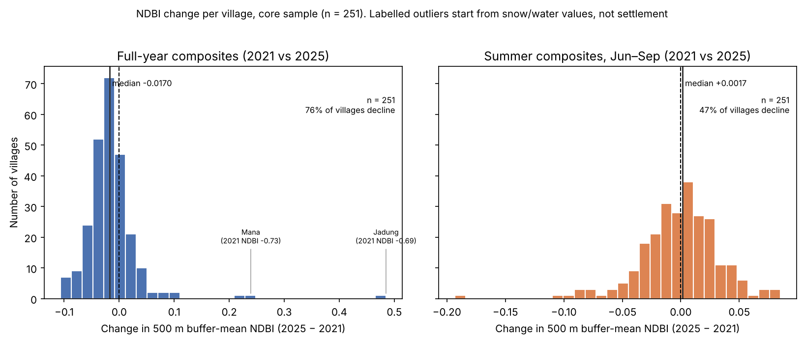

**Figure 2.** NDBI change per priority village, both windows. Labelled values start from snow or water.

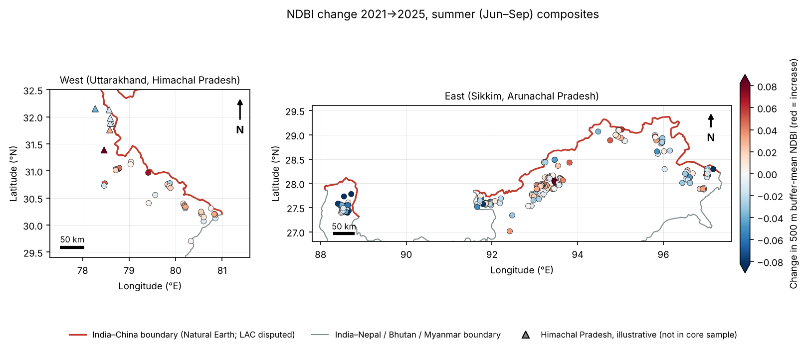

**Figure 3.** Summer NDBI change by village (red = increase). Sikkim's villages (left of the east panel) mostly decline.

### 5.2 Priority versus comparison villages

Table 2 and Figures 4–5 give the DiD estimates.

**Table 2.** Difference-in-differences, 2021→2025 (251 priority vs. up to 721 comparison villages, district fixed effects, district-clustered SE).

| Outcome | Window | δ | 95% CI (t, 13 df) | p (t, 13 df) | Wild bootstrap p |
|---|---|---|---|---|---|
| NDBI | Full year | +0.0067 | −0.0070, +0.0204 | 0.31 | 0.35 |
| NDBI | Summer | −0.0028 | −0.0122, +0.0067 | 0.54 | 0.59 |
| Night lights (nW/cm²/sr) | Full year | +0.035 | −0.065, +0.134 | 0.47 | 0.50 |
| Night lights | Summer | +0.018 | −0.066, +0.102 | 0.65 | 0.68 |
| Sentinel-1 VV (dB) | Full year | +0.006 | −0.049, +0.060 | 0.83 | — |
| Sentinel-1 VV (dB) | Summer | +0.019 | −0.043, +0.081 | 0.52 | — |
| Sentinel-1 VH (dB) | Full year | −0.004 | −0.068, +0.060 | 0.89 | — |
| Sentinel-1 VH (dB) | Summer | +0.000 | −0.087, +0.087 | 1.00 | — |
| Dynamic World built prob. | Full year | +0.0026 | +0.0003, +0.0050 | 0.031 | 0.041 |
| Dynamic World built prob. | Summer | +0.0059 | +0.0022, +0.0097 | 0.004 | 0.008 |

*Dynamic World: 249 treated / 716 comparison villages with valid full-year data; 169 / 536 in summer (no valid Sikkim summer values).*

**Figure 4.** NDBI and night-light DiD estimates with 95% intervals. The green band marks the change in buffer-mean NDBI that doubling a median village's buildings would produce (Section 5.3).

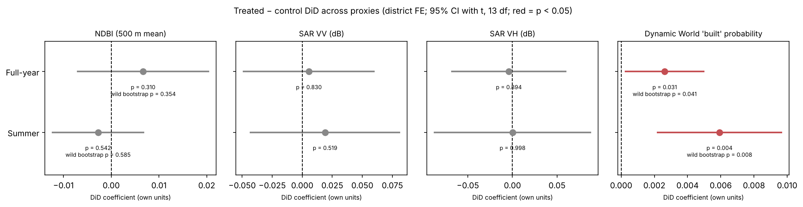

**Figure 5.** DiD estimates for all four measures, each on its own scale.

NDBI, night lights and both radar polarisations show no priority–comparison difference in either window. Dynamic World's built probability rose more in priority villages in both windows. The summer estimate is significant in all 12 leave-one-district-out re-estimations. The full-year estimate is significant in 12 of 14: it loses significance when Dibang Valley or Sikkim's North district is dropped, and without Sikkim it is +0.0023 (p = 0.074). Restricted to the villages that also have summer values, the full-year estimate is +0.0023 (p = 0.12). A 2019→2021 placebo for Dynamic World is null in both windows (p = 0.93 and 0.18), so the difference does not continue an earlier trend.

### 5.3 What the measures could detect

Buildings cover a median 0.33% of a 500 m buffer (90th percentile 2.4%), and 35 of the 251 priority buffers contain no mapped building at all. Table 3 converts this into detectability.

**Table 3.** Detectability of building change by each buffer-mean outcome.

| | NDBI full year | NDBI summer | Dynamic World full year | Dynamic World summer |
|---|---|---|---|---|
| Index change per unit building cover (SE) | 0.84 (0.25) | 0.53 (0.16) | 2.45 (0.26) | 2.24 (0.28) |
| Change from doubling the median village's buildings | +0.0028 | +0.0018 | +0.0081 | +0.0074 |
| …as a share of the DiD's minimum detectable effect | 14% | 13% | — | — |
| DiD estimate as building-equivalent area per village | +6,300 m² | −4,100 m² | +840 m² | +2,080 m² |
| 95% CI, building-equivalent area | −6,600 to +19,100 m² | −18,200 to +10,000 m² | +90 to +1,600 m² | +770 to +3,380 m² |
| Equivalence test vs. ± a doubling | not equivalent | not equivalent | equivalent (bounded effect) | not equivalent |

The NDBI design could not have detected even a doubling of a typical village's buildings. Its confidence intervals are compatible with anything from a loss to a gain of four to seven times a median village's entire building stock. **The NDBI null is therefore uninformative about whether construction happened.** It is not evidence that it did not. Night lights face a related limit, because a VIIRS pixel is about the size of the buffer. Dynamic World responds three to four times more strongly to buildings than NDBI does. Its estimates correspond to roughly 800–2,100 m² of built-up surface per priority village, a third to four-fifths of a median village's footprint area, and the full-year estimate is bounded below a doubling. The conversion assumes the cross-sectional relationship between building cover and index value also holds for change, and Dynamic World's "built" class also responds to roads and cleared ground, so the areas are indicative.

These estimates also explain why the measures disagree. At village level, Dynamic World's change is almost unrelated to the change in NDBI or radar (Spearman ρ between −0.13 and +0.15), and the two point in the same direction in only 31–63% of villages. The measures largely see different surfaces.

### 5.4 Villages with documented new facilities

News reports of an official visit to Anjaw district on 31 October 2023 list new facilities in three sample villages: a civil terminal building and a girls' hostel at Walong, and basketball courts, solar streetlights, a school library and a school building at Kaho and Musai (Arunachal Times, 2023; ANI, 2023). The reports attribute these to the state's Golden Jubilee Model Village programme, which later merged with VVP. The only works they describe as funded under VVP are at Kibithoo, which is not in the sample because its geocoding failed. These villages are therefore cases of documented new facilities, not confirmed VVP positive controls.

Figure 6 places each village's change within the distribution of all 251 villages. Night lights at Kaho and Walong were in the top 5% of all villages (95th and 98th percentiles), and Dynamic World at the 97th and 83rd. Musai was close to the median on both (55th and 64th). NDBI at all three fell further than at most villages (7th–26th percentiles). This is consistent with lights responding to new lighting at two of the three sites, but three villages in one district cannot validate any measure.

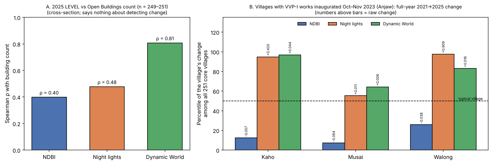

**Figure 6.** (A) Cross-sectional correlation between each measure's 2025 level and building count. (B) The three villages' 2021→2025 change as a percentile of all 251 villages.

### 5.5 Border distance (SQ2)

Pooled across villages, summer NDBI change rises with distance from the boundary (ρ = +0.29, p = 2.6 × 10⁻⁶) and full-year night-light change falls with distance (ρ = −0.25, p = 5.5 × 10⁻⁵). Within districts, neither holds (Table 4, Figure 7). The summer NDBI association disappears (ρ = +0.03, p = 0.78), and the night-light association reverses: within districts, villages *farther* from the boundary gained more light, in both windows (ρ = +0.24, p = 0.021, and +0.42, p < 0.001). Using distance to the China boundary only gives the same pattern. The pooled correlations therefore reflect which districts lie closer to the boundary, not a proximity gradient. Earlier versions of this paper treated them as robust, because they survived leave-one-district-out, randomization and spatial-autocorrelation checks; but none of those checks separates within-district from between-district variation. There is no consistent evidence that change concentrates near the boundary.

**Table 4.** Distance to boundary vs. change: pooled and within-district Spearman correlations.

| Outcome | Window | Pooled ρ (p) | Within-district ρ (permutation p) | Within-district ρ, China boundary only |
|---|---|---|---|---|
| NDBI | Full year | +0.05 (0.44) | −0.37 (< 0.001) | −0.40 (< 0.001) |
| NDBI | Summer | +0.29 (< 0.001) | +0.03 (0.78) | +0.03 (0.79) |
| Night lights | Full year | −0.25 (< 0.001) | +0.24 (0.021) | +0.22 (0.023) |
| Night lights | Summer | −0.07 (0.27) | +0.42 (< 0.001) | +0.41 (0.001) |

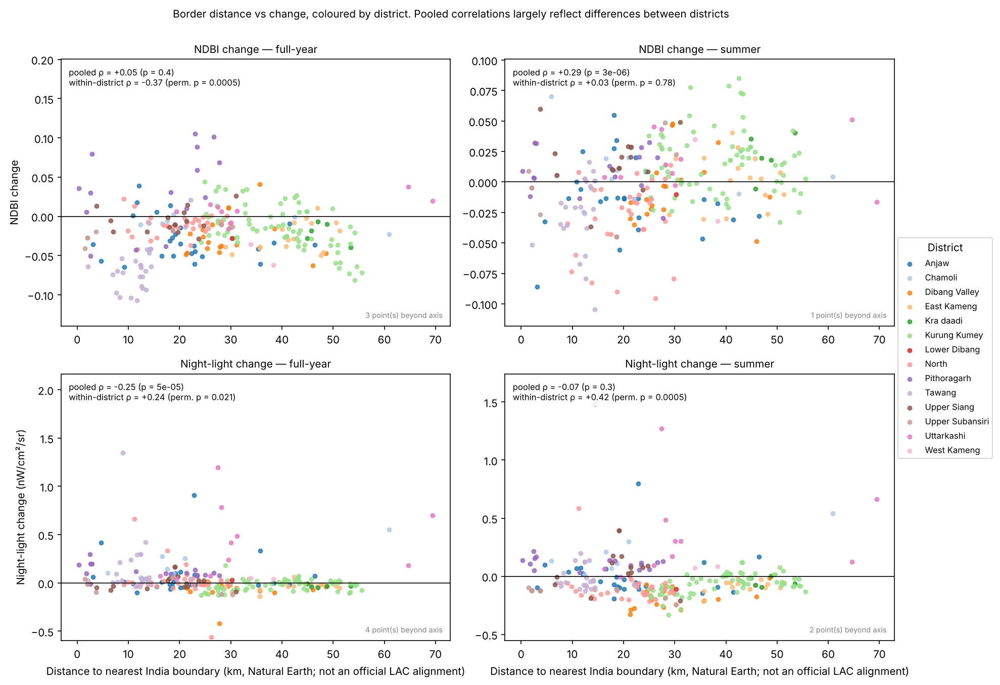

**Figure 7.** Distance to the nearest boundary vs. change, coloured by district, with pooled and within-district correlations.

### 5.6 Budget

Across the three states, mean NDBI change does not follow sanctioned budget: the Spearman correlation is +0.5 in the summer window and −0.5 in the full-year window. With three states this is descriptive only (Appendix Figure A1).

## 6. Robustness

**Table 5.** Robustness of the primary DiD results (NDBI and night lights) and of the Dynamic World result.

| Check | Result |
|---|---|
| Placebo DiD, 2019→2021 | Null for full-year NDBI (p = 0.73), full-year lights (0.76), summer lights (0.52); borderline for summer NDBI (+0.012, p = 0.074; raw distributions differ, p < 0.001). Dynamic World null (0.93, 0.18) |
| 2021 baseline balance | Balanced except full-year night lights (p = 0.036) |
| Leave one district out | NDBI and lights: 0 of 14 significant. Dynamic World: summer 12 of 12, full year 12 of 14 |
| Randomization inference (2,000 within-district permutations) | Summer NDBI p = 0.23, summer lights 0.49, full-year lights 0.34 |
| Without 82 comparison villages within 1 km of a treated village | All four primary DiDs null (p = 0.32–0.78) |
| Without 10 comparison villages that are qualifier-variant priority villages | No change (NDBI p = 0.34/0.53; lights 0.46/0.64; Dynamic World 0.030/0.005) |
| Without the 7 duplicated treated locations, 35 building-free treated buffers (and 61 comparison), and Joshimath | All primary DiDs null; Joshimath alone reverses the sign of mean summer light change |
| Full-year treated values from the project's Python pipeline instead of the Code Editor export | NDBI DiD +0.0029 (p = 0.64); lights unchanged (p = 0.47) |
| Buffer radius 250 m / 1 km (summer, same-day extraction) | Treated-only NDBI change null at all radii (p = 0.12, 0.44, 0.90) |
| SCL cloud mask instead of QA60 | Summer NDBI change null under both (p = 0.29 vs 0.44) |
| Log night lights | Null (full year p = 0.61; summer 0.72) |

*p-values use district-clustered standard errors with a normal reference (as in earlier versions) except where t(13) is stated in Table 2; the t(13) values are slightly larger and change no conclusion.*

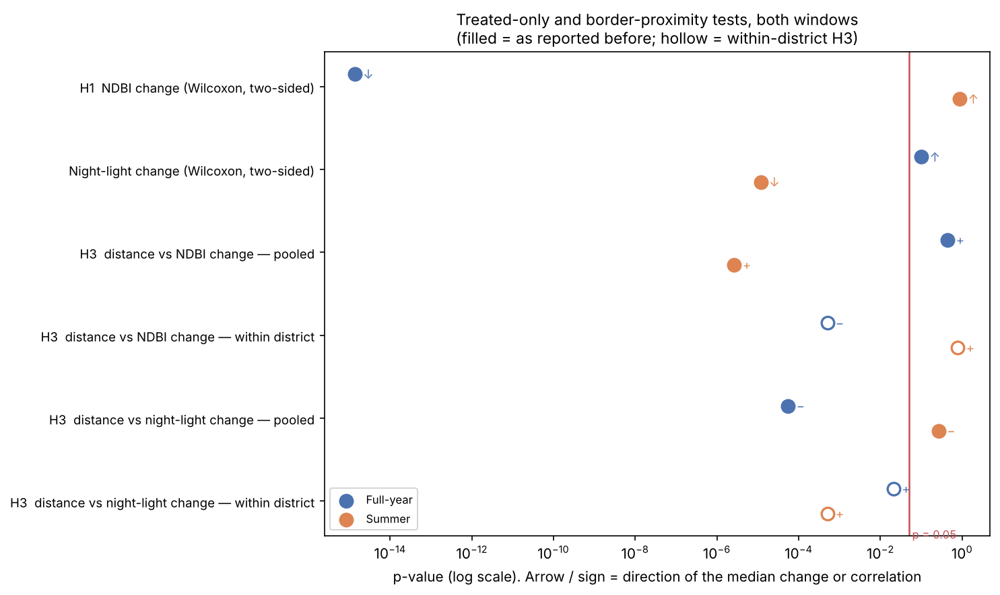

**Figure 8.** Treated-only and border-distance tests, both windows, including within-district versions.

The three-point trend (Figure 9) shows NDBI falling from 2021 to 2023 and recovering by 2025 in both windows. Sentinel-2's QA60 cloud band is not populated for most of 2022–2024 in the harmonized collection, so the 2023 composites may be effectively unmasked, and the dip should not be interpreted.

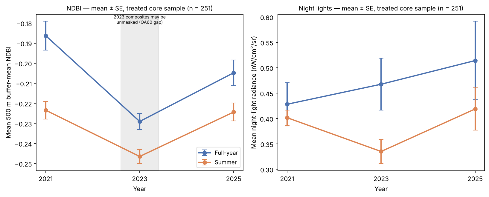

**Figure 9.** Mean NDBI and night lights in priority villages, 2021, 2023, 2025.

## 7. Discussion

The headline answer is a qualified one. Using the outcomes this study set out to use (buffer-mean NDBI and night lights), priority villages did not change differently from comparison villages between 2021 and 2025. But for NDBI that comparison could not have detected the scale of construction a village-level programme produces, so it does not show that nothing was built. The one measure that responds strongly to buildings, Dynamic World, does show a small positive difference: equivalent to several hundred to about two thousand square metres of built-up surface per village, robust in the summer window and dependent on Sikkim in the full-year window. Radar shows nothing, which may reflect its own low sensitivity at this scale as much as an absence of change.

Three readings of the Dynamic World result remain open. It may be a real but small early programme effect that the other measures are too coarse to register. It may reflect something other than buildings that the classifier labels as built: road widening, cleared construction sites, or the state model-village works that preceded VVP. Or it may be a false positive specific to the classifier. The placebo rules out a pre-existing trend, and the result survives small-cluster inference. Settlement-footprint outcomes and a 2026 follow-up (Section 8) are the most direct way to tell these apart.

Timing matters for every reading. The programme was approved in February 2023 and launched in April 2023, and the documented new facilities in the sample date from late 2023. A 2025 endpoint captures at most about two years of possible works, and nothing in the public record shows how many works were complete by then. The estimate is the effect of priority *designation* after about two years, not the effect of completed works.

For the securitization question, the evidence is negative but weak. The pooled association with border distance came from differences between districts, and within districts night lights grew more in villages farther from the boundary. No consistent pattern supports prioritisation of the villages closest to the border.

Beyond VVP-I, the study illustrates a general point for evaluations that use satellite indices. Before reporting a null result, it is worth estimating how much the outcome would move under a plausible effect. Here that single calculation changes the interpretation of the main result.

### Limitations

- **Treatment definition.** Priority designation is observed; completed works are not. Comparison villages may include non-priority VVP-I villages, which would bias estimates toward zero.
- **Geocoding.** Only 251 of 552 listed villages in the three states were geocoded, and success varies strongly by district (Arunachal Pradesh χ² = 139, p = 6 × 10⁻²⁵; Tawang 17%, Shiyomi 0%). Within Arunachal Pradesh, geocoded villages do not differ in population (p = 0.31). Positional accuracy has not been verified: 86 villages were located by a fallback query without block information, 35 buffers contain no mapped building, 7 pairs of villages share coordinates, and Kibithoo could not be located.
- **Measurement.** Buffer means dilute village-scale change (Section 5.3). Full-year composites include snow. The 2023 composites may be unmasked. VIIRS pixels are about the size of the buffer.
- **Inference.** There are 14 district clusters; small-cluster methods are used throughout, but power for district-level confounding is limited. Assignment is administrative, not random. Spatial autocorrelation among villages is present (summer NDBI change: Moran's I = 0.35, p = 0.001).
- **Coverage.** Himachal Pradesh and Ladakh are not analysed, because no name-level lists are public.
- **Boundaries.** Distances use Natural Earth cartographic lines; the Line of Actual Control is disputed, and distances are comparative only.

## 8. Next steps

The following analyses are prepared in the repository (`docs/NEXT_STEPS_EARTH_ENGINE.md`) and require a live Earth Engine session or manual work:

1. **Settlement-targeted outcomes.** NDBI and Dynamic World inside each village's Open Buildings footprint zone, Dynamic World built-up area in square metres, Cloud Score+ masking and cloud-filtered VIIRS, for 2019, 2021, 2025 and summer 2026 (`extract_settlement_masked.py`, `settlement_masked_did.py`).
2. **Same-day re-extraction** of full-year values for treated and comparison villages with the repository's own script.
3. **Geocode review** of every point against high-resolution imagery, including the 35 building-free buffers, the duplicated locations, Joshimath and Kibithoo.
4. **Works data** for a subset of priority villages, to estimate effects where works are known to be complete, and a check of comparison villages against the VVP-I block list.

## 9. Data, code and revision history

All code, data and outputs are in the project repository (CC BY 4.0). `ANALYSIS_FREEZE.md` records the data and code state behind this version, and `tests/test_data_integrity.py` checks the data invariants the results depend on.

This study's results changed several times as errors were found and corrected; each change is recorded in `BO_Development_Log.md` and summarised in `BO_Results_Stability_Table.md`. In brief:

- an early significant summer NDBI increase disappeared when an incomplete extraction, which had returned no summer scenes for any Sikkim village, was redone;
- a significant full-year night-light DiD disappeared when 23 comparison villages that duplicated priority villages were removed;
- an apparent disagreement between cloud masks was a coding error (snow counted as clear).

The cause of the original Sikkim gap is not established; a check is prepared (`check_s2_archive_ingestion.py`).

Version 2.0 followed an independent review (Development Log Entry 49). It changed four things:

- the primary analysis became the DiD rather than the treated-only change;
- it added the detectability analysis, small-cluster inference for Dynamic World, and the within-district border-distance analysis, which reverses the earlier interpretation of the border correlations;
- it corrected the attribution of the Anjaw facilities;
- it added the sample-quality sensitivity checks.

## References

ANI. (2023, October 31). Arunachal DyCM Chowna Mein inaugurates 15 projects in Anjaw villages. https://aninews.in/news/national/general-news/arunachal-dycm-chowna-mein-inaugurates-15-projects-in-anjaw-villages20231031233238/

Arunachal Times. (2023, November 1). DCM inaugurates several projects in Anjaw. https://archive.arunachaltimes.in/index.php/2023/11/01/dcm-inaugurates-several-projects-in-anjaw/

Brown, C. F., Brumby, S. P., Guzder-Williams, B., et al. (2022). Dynamic World, near real-time global 10 m land use land cover mapping. *Scientific Data*, 9, 251. https://doi.org/10.1038/s41597-022-01307-4

Buzan, B., Wæver, O., & de Wilde, J. (1998). *Security: A New Framework for Analysis*. Lynne Rienner.

Cameron, A. C., Gelbach, J. B., & Miller, D. L. (2008). Bootstrap-based improvements for inference with clustered errors. *Review of Economics and Statistics*, 90(3), 414–427. https://doi.org/10.1162/rest.90.3.414

Cameron, A. C., & Miller, D. L. (2015). A practitioner's guide to cluster-robust inference. *Journal of Human Resources*, 50(2), 317–372. https://doi.org/10.3368/jhr.50.2.317

Elvidge, C. D., Baugh, K., Zhizhin, M., Hsu, F. C., & Ghosh, T. (2017). VIIRS night-time lights. *International Journal of Remote Sensing*, 38(21), 5860–5879. https://doi.org/10.1080/01431161.2017.1342050

Lakens, D. (2017). Equivalence tests: A practical primer for t tests, correlations, and meta-analyses. *Social Psychological and Personality Science*, 8(4), 355–362. https://doi.org/10.1177/1948550617697177

Ministry of Home Affairs. (2023a, August 9). *Rajya Sabha Unstarred Question No. 2321: Vibrant Villages Programme*. https://www.mha.gov.in/MHA1/Par2017/pdfs/par2023-pdfs/RS09082023/2321.pdf

Ministry of Home Affairs. (2023b, March 29). *Rajya Sabha Question No. 3251: Vibrant Villages Programme*. https://www.mha.gov.in/MHA1/Par2017/pdfs/par2023-pdfs/RS29032023/3251.pdf

Ministry of Home Affairs. (2023c, March 14). *Lok Sabha Question No. 2104: Vibrant Villages Programme*. https://www.mha.gov.in/MHA1/Par2017/pdfs/par2023-pdfs/LS14032023/2104.pdf

Ministry of Home Affairs. (2025). *Lok Sabha Question No. 4360: Vibrant Villages Programme*. https://sansad.in/ls/questions/questions-and-answers

Ministry of Home Affairs. (2026, February 3). *Lok Sabha Unstarred Question No. 508: Vibrant Villages Programme*. https://www.mha.gov.in/MHA1/Par2017/pdfs/par2026-pdfs/LS03022026/508.pdf

Natural Earth. (2024). *1:10m Cultural Vectors, Admin 0 Boundary Lines*. https://www.naturalearthdata.com/

OpenStreetMap contributors. (2024). OpenStreetMap data via Nominatim and the Overpass API. Data © OpenStreetMap contributors, ODbL. https://www.openstreetmap.org/copyright

Sirko, W., Kashubin, S., Ritter, M., et al. (2021). Continental-scale building detection from high resolution satellite imagery. arXiv:2107.12283. https://arxiv.org/abs/2107.12283

Outlook India. (2023, April). Shah to visit Arunachal village along China border to launch the Vibrant Villages Programme. https://www.outlookindia.com/national/shah-to-visit-arunachal-village-along-china-border-to-launch-the-vibrant-villages-programme-news-277237

Spearman, C. (1904). The proof and measurement of association between two things. *American Journal of Psychology*, 15(1), 72–101.

Wilcoxon, F. (1945). Individual comparisons by ranking methods. *Biometrics Bulletin*, 1(6), 80–83.

Zha, Y., Gao, J., & Ni, S. (2003). Use of normalized difference built-up index in automatically mapping urban areas from TM imagery. *International Journal of Remote Sensing*, 24(3), 583–594. https://doi.org/10.1080/01431160304987

## Appendix

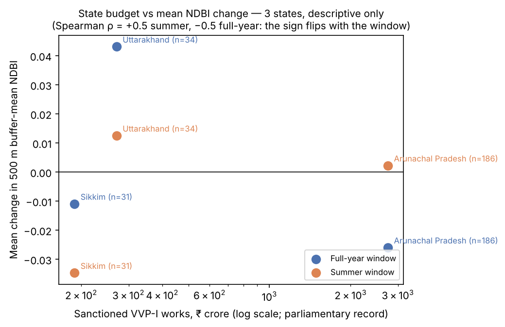

**Figure A1.** State budget vs. mean NDBI change, both windows (n = 3, descriptive).

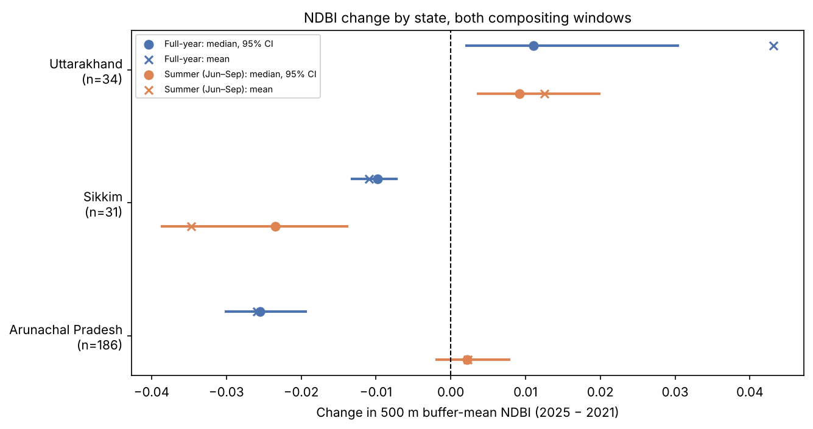

**Figure A2.** NDBI change by state: medians with 95% bootstrap intervals and means.

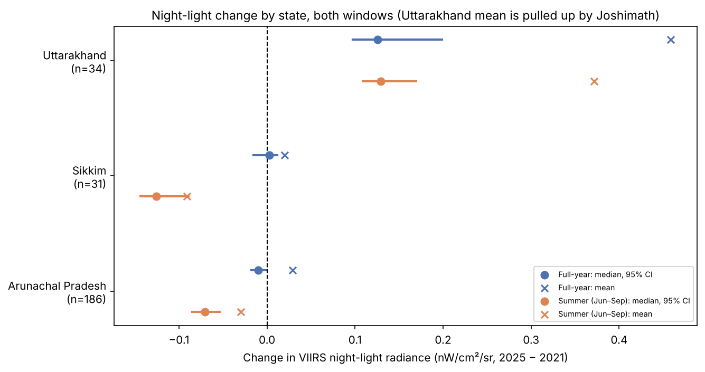

**Figure A3.** Night-light change by state.

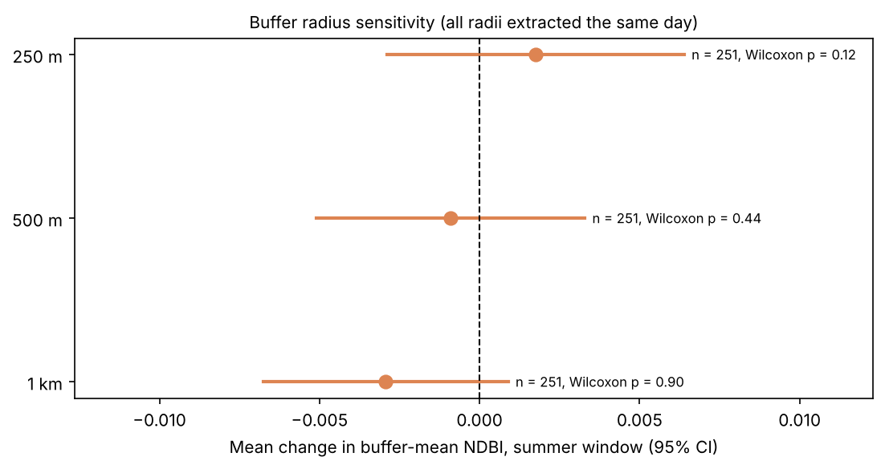

**Figure A4.** Treated-only NDBI change at three buffer radii (summer window).

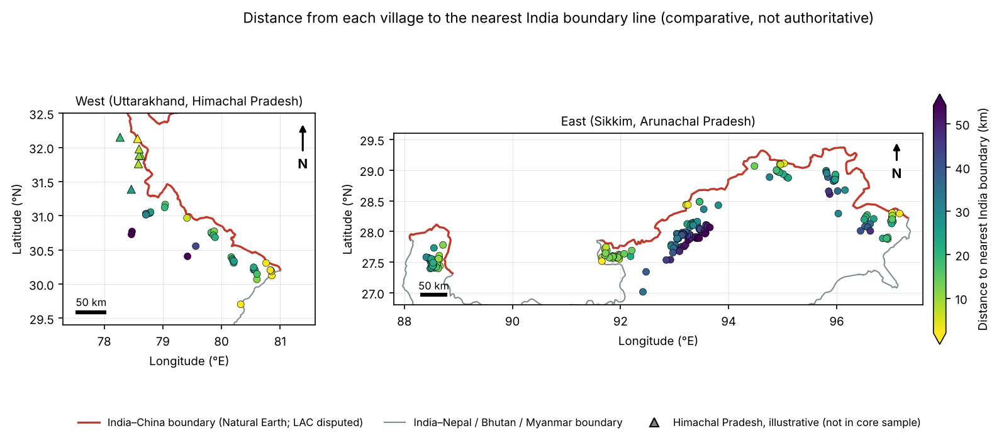

**Figure A5.** Distance from each village to the nearest India boundary line.
