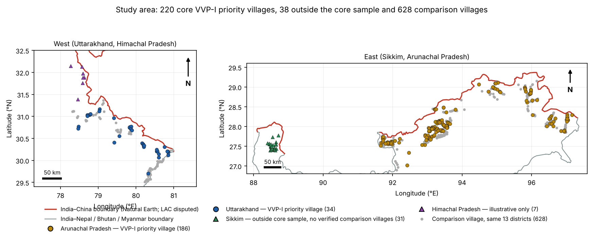
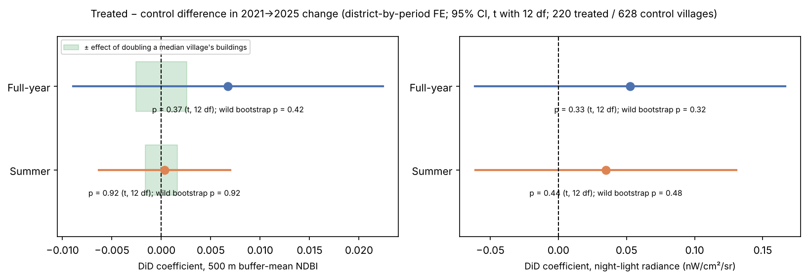

Executive Summary · Sakshi D. Maske · Version 2.1 (November 2026)

**Keywords:** programme evaluation · place-based policy · comparative policy · public expenditure · evidence and policy · monitoring indicators · Earth observation · difference-in-differences

## The question

India's Vibrant Villages Programme (VVP-I), a place-based development programme approved in February 2023 with an outlay of about ₹4,800 crore, targets 2,967 villages on the northern border, 662 of them designated priority villages. In February 2026 the Ministry of Home Affairs told Parliament that "no impact assessment has been carried out" (Lok Sabha Unstarred Question No. 508).

**This study asks: did VVP-I priority villages show more satellite-observed built-up and night-light change between 2021 and 2025 than non-priority villages in the same districts?** It also asks how much change the satellite measures could actually detect, and whether change is concentrated near the international boundary. The programme is often described as India's answer to China's 628 "Xiaokang" villages across the same disputed border, so it is also a case for comparing how two states use settlement policy in border regions (Kumar, 2024, Observer Research Foundation).

## Data and method

- **Villages.** 220 priority villages geocoded in Arunachal Pradesh (186) and Uttarakhand (34), plus 628 comparison villages from OpenStreetMap in the same 13 districts. Sikkim's 31 villages are left out, because none of its comparison villages could be verified inside its district. Seven Himachal Pradesh villages are shown as illustrations only; Ladakh has no public village list.
- **Satellite measures,** each averaged over a 500 m buffer around the village, for 2021 and 2025, in full-year and June–September composites (Google Earth Engine):
  - Sentinel-2 NDBI (built-up index)
  - VIIRS night lights
  - Sentinel-1 radar backscatter
  - Dynamic World built-up probability
  - Google Open Buildings footprints, used for validation
- **Design.** A difference-in-differences comparison of priority and comparison villages within the same district (district-by-period fixed effects). Inference suited to 13 district clusters: t with 12 degrees of freedom and an exact wild cluster bootstrap. Checks: a 2019–2021 placebo, leave-one-district-out, randomization inference and sample-quality sensitivity.
- **Detectability.** For each measure, how much it moves per square metre of building, estimated from the footprint data, and therefore what change it could have detected.

## Findings

1. **Built-up index, night lights and radar: no difference** between priority and comparison villages in either window (all p ≥ 0.33; Table below).
2. **That null cannot rule out construction.** Buildings cover a median 0.32% of a 500 m buffer. Doubling a typical village's buildings would move buffer-mean NDBI by about 0.002, only 12–17% of the smallest effect the design can detect. The NDBI result is uninformative. It is not evidence that nothing was built.
3. **Dynamic World, the measure most sensitive to buildings, shows a small positive difference in the summer window.** It is roughly 1,900 m² of built-up surface per priority village (an approximate conversion) and passes the small-cluster bootstrap (p = 0.017). It survives every check, including a correction for testing several measures. The full-year estimate is smaller and not significant (p = 0.067). A 2019–2021 placebo is clean, so the summer result is not an earlier trend continuing.
4. **No consistent border-proximity pattern.** Pooled correlations between change and border distance reflect differences between districts. Within districts they disappear (built-up index) or reverse (night lights grew more in villages *farther* from the border).

| Outcome | Full year: difference (p) | Summer: difference (p) |
|---|---|---|
| NDBI (built-up index) | +0.0067 (0.37) | +0.0003 (0.92) |
| Night lights | +0.053 (0.33) | +0.035 (0.44) |
| Sentinel-1 VV / VH | −0.003 / −0.005 (0.92 / 0.87) | +0.012 / −0.008 (0.66 / 0.85) |
| Dynamic World built probability | +0.0024 (0.067; bootstrap 0.072) | **+0.0050 (0.006; bootstrap 0.017)** |

*NDBI and night-light differences with 95% intervals. The green band shows the change that doubling a typical village's buildings would produce. The intervals are several times wider.*

## What it means

On the measures this study set out to use, there is no detectable programme effect by 2025. Those measures, however, are too coarse to register village-scale construction, so the evidence does not show that nothing happened. The only building-sensitive measure points to a small positive effect in the summer window. It may be early programme construction, related works such as roads or the state's model-village schemes, or a classifier artefact, and this study cannot yet tell which. Two years after launch is also early for physical works to appear.

## Lessons for programme monitoring

- **The indicator decides what an evaluation can find.** A buffer-average built-up index could not show even a doubling of a village's buildings. A monitoring system should check what an indicator can detect before a null result is used as evidence.
- **Public data made this evaluation possible.** Village lists for Himachal Pradesh and Ladakh, and a list of sanctioned and completed works per village, would allow a direct test of whether completed works changed villages.
- **A comparison group already exists.** Priority villages were named in advance, so non-priority villages in the same districts can serve as a comparison group in a regular evaluation.

## Limitations

- Treatment is priority *designation*. Completed works are not observed. Comparison villages may include non-priority VVP-I villages.
- 220 of the 506 listed villages in Arunachal Pradesh and Uttarakhand are in the sample, unevenly across districts, and positions are not yet verified against imagery: 29 buffers contain no mapped building, 7 pairs share coordinates, and Kibithoo (where VVP was launched) could not be located.
- Full-year composites include snow. 2023 composites may be unmasked. VIIRS pixels are about the buffer's size.
- 13 district clusters; administrative, not random, selection. Sikkim is not analysed.

## Next steps (prepared, need Earth Engine)

1. Outcomes measured inside each village's building footprint zone, Dynamic World built-up area in m², and a 2026 follow-up.
2. Same-day re-extraction of the full-year data.
3. Sikkim comparison villages rebuilt inside a verified district boundary.
4. Geocode review against high-resolution imagery.
5. Works-completion data for a subset of villages.
6. Possible extensions: the programme's environmental footprint (forest loss, slope disturbance, landslide exposure) and a comparison with China's Xiaokang villages.

## How this result was reached

Earlier versions reported effects that disappeared once data problems were fixed:
- an incomplete Sikkim extraction
- comparison villages that duplicated priority villages
- a snow error in a cloud mask

Version 2.0 followed an independent review. It moved the primary analysis to the difference-in-differences, added the detectability and within-district analyses, corrected the attribution of the Anjaw case villages, and added sample-quality checks. Version 2.1 followed a second review of the code and data. It found that most of Sikkim's comparison villages lay outside the district (many in Nepal, Bhutan or West Bengal) and that the model did not compare villages within districts. With both fixed, the full-year Dynamic World result is no longer significant. The other results stand. Every change is recorded in `BO_Development_Log.md` and summarised in `BO_Results_Stability_Table.md`.

---

GitHub: github.com/sakshimaske303-commits/BORDER_OPTICS | Live Dashboard: borderoptics-bkx3lpcvfghdpa2hmuqwsg.streamlit.app

Sakshi D. Maske — Independent Geospatial Researcher
