**Sakshi D. Maske**
Independent Geospatial Researcher

Version 2.1 (November 2026). Earlier versions and the full record of changes are listed under Declarations.

## Highlights

- India's Vibrant Villages Programme has an outlay of about ₹4,800 crore, but the government says no impact assessment has been carried out.
- The study compares 220 priority villages with 628 non-priority villages in the same 13 districts, using four satellite measures, 2021–2025.
- NDBI, night lights and radar show no difference. Dynamic World shows a small increase in the summer window, roughly 1,900 m² of built-up surface per village (an approximate conversion).
- The NDBI design could not have detected even a doubling of a village's buildings, so its null result does not show that nothing was built.
- For monitoring public programmes, the choice of indicator decides what an evaluation is able to find.

## Abstract

India's Vibrant Villages Programme (VVP-I), a place-based development programme approved in February 2023 with an outlay of about ₹4,800 crore, targets 2,967 villages on the northern border, 662 of them designated priority villages. In February 2026 the Ministry of Home Affairs told Parliament that no impact assessment had been carried out. This study asks whether priority villages show more satellite-observed physical change between 2021 and 2025 than non-priority villages in the same districts. We compare 220 geocoded priority villages in Arunachal Pradesh and Uttarakhand with 628 comparison villages from OpenStreetMap in the same 13 districts. Sikkim is left out, because its comparison villages could not be checked against a district boundary and most of them were outside the district. For each village we extracted Sentinel-2 NDBI, VIIRS night lights, Sentinel-1 backscatter and Dynamic World built-up probability within a 500 m buffer, under full-year and June–September composites. We estimated difference-in-differences models with district-by-period fixed effects, so that villages are compared only with villages in their own district, and with district-clustered inference (t with 12 degrees of freedom and an exact wild cluster bootstrap). NDBI, night lights and radar show no treated–control difference (all p ≥ 0.33). Dynamic World shows a small positive difference in the summer window (p = 0.006; bootstrap p = 0.017), roughly 1,900 m² of built-up surface per village. It passes every check, including a Holm correction across the triangulation outcomes. The full-year estimate is smaller and not significant (p = 0.067). A detectability analysis shows why the indices disagree: buildings cover a median 0.32% of a 500 m buffer, so doubling a village's buildings would move buffer-mean NDBI by about 0.002, less than a fifth of the smallest effect the NDBI design can detect. So the NDBI null cannot show whether construction took place. A pooled association between change and border distance disappears or reverses within districts. Settlement-footprint outcomes and a 2026 follow-up are prepared as the next step. For programme monitoring, the results show that a satellite indicator should be checked for what it can detect before a null result is used as evidence, and that village-level data on completed works would allow a direct evaluation.

**Keywords:** programme evaluation; place-based policy; comparative policy; public expenditure; evidence and policy; policy design; monitoring indicators; Vibrant Villages Programme; Earth observation; difference-in-differences; Sentinel-2; Sentinel-1; VIIRS; Dynamic World; Google Open Buildings; detectability; border regions; India.

---

## 1. Introduction

Large public programmes in remote regions are hard to evaluate on the ground. India's Vibrant Villages Programme (VVP-I) is one of them. Approved by the Union Cabinet in February 2023, it funds roads, power, communications, tourism and livelihood works in 2,967 villages across 46 blocks and 19 districts of Arunachal Pradesh, Sikkim, Uttarakhand, Himachal Pradesh and Ladakh, with 662 villages designated as priority villages for the first phase (Ministry of Home Affairs, 2023a, 2023b). Asked in the Lok Sabha whether the programme's impact had been assessed, the Ministry replied that "no impact assessment has been carried out" (Ministry of Home Affairs, 2026).

In policy-instrument terms, VVP-I is public spending targeted at named places, which makes it a place-based policy (Neumark & Simpson, 2015). It is also widely described as India's answer to a similar programme on the other side of the border: since 2017 China has built 628 "Xiaokang" villages, many of them close to the Line of Actual Control (Kumar, 2024). Two governments are therefore building up villages along the same disputed border, which makes VVP-I a useful case for comparing how states use settlement policy in border regions. Whether a policy delivers what it promises is a central question in comparative policy research (Arvanitopoulos et al., 2026). How evidence enters policy decisions is itself a policy question (Cairney, 2016). For VVP-I, the first problem is that there is little evidence to use.

Satellite data offer an independent view of such places, and they have been used to study infrastructure and rural development in many countries (Donaldson & Storeygard, 2016). They also carry a risk: an index averaged over an area much larger than the change of interest can miss real change, and a null result from such an index can be mistaken for evidence that nothing happened. We test for this problem directly in SQ1 below. Building roads and settlements in the high Himalaya can also cost forest cover and raise landslide risk. This study does not measure those effects, but the same satellite design could (Section 8).

**Research question.** *Did VVP-I priority villages show more satellite-observed built-up and night-light change between 2021 and 2025 than non-priority villages in the same districts?*

There are two subsidiary questions:

- **SQ1 (measurement).** How large a change could each satellite measure, as implemented, actually detect?
- **SQ2 (pattern, descriptive).** Is change related to distance from the international boundary, as a securitization reading of the programme would suggest (Buzan, Wæver, & de Wilde, 1998)?

As far as we know, this is the first independent satellite assessment of VVP-I. The study uses four satellite measures (an optical index, night lights, radar and a machine-learned land-cover product) together with a building footprint dataset in one difference-in-differences design. It also estimates, in square metres of buildings, how much change each buffer-averaged measure is able to detect.

## 2. Background

### 2.1 The programme

VVP-I's state-wise sanctioned works total about ₹3,431 crore. Of this, ₹2,749.74 crore (2,082 works) is in Arunachal Pradesh, ₹270.58 crore (200 works) in Uttarakhand, ₹188.90 crore (63 works) in Sikkim, ₹126.01 crore in Himachal Pradesh and ₹95.76 crore in Ladakh, against the approved outlay of about ₹4,800 crore. Village-wise priority lists are public for Arunachal Pradesh and Sikkim (Ministry of Home Affairs, 2023a). For Uttarakhand, official sources give block and district counts only, and the 51 names used here come from a secondary list whose 14/27/10 district split matches the official counts. Himachal Pradesh (75 priority villages) and Ladakh (35) have no published name-level lists. The programme was formally launched at Kibithoo, Arunachal Pradesh, in April 2023, so physical works in priority villages could have begun only after that date (Outlook India, 2023).

### 2.2 Measuring settlement change from space

The Normalized Difference Built-up Index, NDBI = (SWIR1 − NIR)/(SWIR1 + NIR), is a standard spectral proxy for built-up surface (Zha, Gao, & Ni, 2003), but it also responds to bare soil, rock and snow. VIIRS Day/Night Band radiance tracks electrification and activity (Elvidge et al., 2017) at a resolution of roughly 500–750 m. Sentinel-1 C-band backscatter responds to built structures independently of clouds. Google's Dynamic World provides a per-pixel probability of the "built" class from a deep-learning model applied to Sentinel-2 (Brown et al., 2022), and Google Open Buildings provides building footprints from high-resolution imagery (Sirko et al., 2021). These measures differ in what they see, at what resolution, and how much non-settlement surface enters a buffer average; using all of them lets each be checked against the others.

## 3. Data

### 3.1 Villages

| Source | Use |
|---|---|
| Arunachal Pradesh identified-villages list; Rajya Sabha Q. 2321 (2023) annexure | Priority villages, Arunachal Pradesh and Sikkim |
| Secondary list matched to Uttarakhand Rural Development Department counts | Priority villages, Uttarakhand |
| OpenStreetMap Nominatim; ISRO Bhuvan village geocoder | Village coordinates |
| OpenStreetMap Overpass (place = village / hamlet) | Comparison villages |
| Natural Earth 1:10m Admin-0 boundary lines | Distance to boundary (cartographic, not authoritative) |
| Google Open Buildings v3 | Building footprints (validation, detectability) |

We started from 559 named priority villages: 552 in Arunachal Pradesh, Sikkim and Uttarakhand (Table 1) and 7 in Himachal Pradesh. Of these, 258 were geocoded and district-verified. The core sample is the 220 villages in Arunachal Pradesh (186 of 455) and Uttarakhand (34 of 51). Sikkim's 31 geocoded villages are outside the core sample, because Sikkim has no verified comparison villages (Section 3.2). The 7 Himachal Pradesh villages are shown only as illustrations. Figure 1 maps the sample.

**Table 1.** Sample.

| | Arunachal Pradesh | Uttarakhand | Total core | Sikkim (outside core) |
|---|---|---|---|---|
| Listed priority villages | 455 | 51 | 506 | 46 |
| Geocoded | 186 | 34 | 220 | 31 |
| Districts | 10 | 3 | 13 | 1 |
| Comparison villages | 526 | 102 | 628 | none verified |

*The 13 districts are the clusters for all inference (Arunachal Pradesh: Anjaw, Dibang Valley, East Kameng, Kra Daadi, Kurung Kumey, Lower Dibang, Tawang, Upper Siang, Upper Subansiri, West Kameng; Uttarakhand: Chamoli, Pithoragarh, Uttarkashi). Sikkim's North district was part of the sample until Version 2.0 (Section 3.2).*

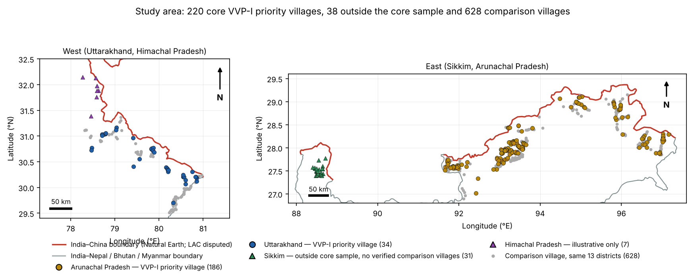

**Figure 1.** Study area. Core priority villages by state, villages outside the core sample (triangles: Sikkim, and the illustrative Himachal Pradesh villages) and comparison villages (grey). Boundary lines are Natural Earth cartographic lines; the Line of Actual Control is disputed and is not represented authoritatively.

### 3.2 Comparison villages

Comparison villages are OpenStreetMap village and hamlet nodes in the same 13 districts, each checked against a district boundary polygon. We excluded any node within 50 m of a priority village and any node whose name matches an official priority village. Within each district we kept candidates within 1.5 times the treated villages' maximum border distance, up to three times the number of treated villages, taking the candidates closest to the border first. This yields 628 villages.

Sikkim was handled differently up to Version 2.0. No polygon could be retrieved for its North district, so the selection code used a box of about 65 km around the district's priority villages instead. Because the candidates closest to the border were taken first, the box picked up villages along the Nepal and Bhutan borders. By their own coordinates, 84 of the 93 Sikkim comparison villages lie outside North Sikkim, and many of them are in Nepal, Bhutan or West Bengal. A second review of the code and data found this. From Version 2.1, a comparison village is used only if its district was checked against a polygon. This leaves Sikkim with no valid comparison villages, so its 31 priority villages are also outside the core sample. A test in the repository now checks this rule.

This group excludes priority villages but not the programme's other, non-priority villages. Because those are not listed by name, some comparison villages may themselves be VVP-I villages. So the estimate compares priority and non-priority villages within programme districts. It does not compare programme villages with villages outside the programme. An audit in this version also found 10 comparison villages that are official priority villages written with a qualifier the name filter did not strip ("Sawa" vs "Sawa H.Q."). Removing them changes no result (Section 6), and the selection code now excludes them for future runs.

### 3.3 Satellite data

For each village we used a 500 m radius buffer around the geocoded point and two compositing windows: full year (January–December) and summer (June–September, largely snow-free but cloudier). Periods are 2021 (before) and 2025 (after), with 2019 as a second pre-treatment year for placebo tests and 2023 as a mid-point.

| Measure | Collection (Google Earth Engine) | Processing | Scale |
|---|---|---|---|
| NDBI | COPERNICUS/S2_SR_HARMONIZED | QA60 cloud and cirrus mask, median composite, (B11 − B8)/(B11 + B8), buffer mean | 10 m |
| Night lights | NOAA/VIIRS/DNB/MONTHLY_V1/VCMSLCFG | mean of monthly avg_rad, buffer mean | 500 m |
| Radar | COPERNICUS/S1_GRD | IW mode, single orbit direction, VV and VH median, buffer mean | 20 m |
| Built probability | GOOGLE/DYNAMICWORLD/V1 | median "built" probability, buffer mean | 10 m |
| Buildings | Google Open Buildings v3 | footprint count and area in buffer | vector |

Treated and comparison villages were extracted with identical code, except for the full-year NDBI and night-light values of treated villages. Those come from an earlier export made in the Earth Engine Code Editor; the script is not preserved, and the values were extracted about seven weeks before the comparison villages'. The project's own Python pipeline gives night-light values that match, but its NDBI values do not match closely. For the same villages and years, NDBI differs by more than 0.01 at 164 of the 220 villages in 2021 and 190 in 2025 (correlation 0.98). That is more than the change a doubling of buildings would produce (Section 5.3). Section 6 shows that using the Python values changes no conclusion, but the full-year NDBI values cannot be exactly reproduced. Section 8 lists a same-day re-extraction as a required next step.

## 4. Methods

### 4.1 Difference-in-differences (primary analysis)

For outcome *y* of village *i* in district *d* and period *t* ∈ {2021, 2025}:

*y*ᵢₜ = α + β·Treatedᵢ + δ·(Treatedᵢ × Postₜ) + μ_d + λ_d·Postₜ + εᵢₜ

δ is the difference between priority and comparison villages in their 2021→2025 change. μ_d are district fixed effects, and λ_d gives each district its own 2021→2025 change, so δ compares priority and comparison villages only within the same district. With two periods, district fixed effects alone would cancel out of δ. Version 2.0 used only those, so its estimate was in effect a comparison pooled across districts (Declarations). Standard errors are clustered by district. With only 13 clusters we report p-values from a t distribution with 12 degrees of freedom and an exact wild cluster bootstrap (Rademacher weights, null imposed, all 2¹³ = 8,192 sign vectors; Cameron, Gelbach, & Miller, 2008; Cameron & Miller, 2015). A village first-difference regression with district fixed effects gives the same estimates. Treatment is *designation* as a priority village (intent to treat). We do not observe which villages received completed works by 2025.

The pre-specified primary outcomes are NDBI and night lights. Radar and Dynamic World are triangulation outcomes. The treated-only before/after change is reported descriptively, because it cannot separate programme effects from regional trends. (Earlier versions treated it as the primary estimand; this was changed in Version 2.0, see Declarations.)

### 4.2 Identifying assumptions and checks

The design assumes that, without the programme, priority and comparison villages in the same district would have changed alike. We check this with:

- a placebo DiD over 2019→2021, before the programme existed;
- a 2021 baseline balance test;
- leave-one-district-out re-estimation;
- randomization inference within districts;
- re-estimation without the 82 comparison villages whose buffers overlap a treated buffer.

Priority villages were selected administratively, so these checks support the assumption but cannot prove it.

### 4.3 What can each measure detect? (SQ1)

A buffer mean can only move as much as the surface that changes. We estimate each index's response to buildings from the data. Across all 848 villages, we regress the 2025 buffer-mean value on the share of the buffer covered by Open Buildings footprints, with district fixed effects. The slope is the change in the index per unit of building cover. Combining it with the median village's building area gives the change a plausible amount of construction would produce, which we compare with each design's minimum detectable effect (MDE; α = 0.05, power 0.8, t with 12 df for the DiD). We also express every DiD estimate and confidence bound as "building-equivalent area" per village. Finally, we run an equivalence test (two one-sided tests; Lakens, 2017) against a smallest effect of interest equal to a doubling of the median village's buildings.

### 4.4 Border distance (SQ2)

We compute the geodesic distance from each village to the nearest India boundary line, and separately to the India–China boundary only, because 30 core villages are nearest to Bhutan, Nepal or Myanmar. We report the pooled Spearman correlation between distance and change, and a within-district correlation: villages ranked inside their own district, with a permutation test that shuffles distance only within districts. Comparing the two shows whether a pooled association reflects a gradient inside districts or differences between districts.

### 4.5 Multiple testing

The primary family is the four NDBI and night-light DiD estimates. Holm-adjusted, all four equal 1.000. The six triangulation DiDs (radar VV and VH, Dynamic World; both windows) form a second family, also Holm-adjusted (`triangulation_holm.py`). Border-distance and robustness results are reported as secondary, with exact p-values, and are not used to make the headline claim.

## 5. Results

### 5.1 What changed in priority villages

Figure 2 shows the treated villages' own 2021→2025 change. In the full-year window, buffer-mean NDBI fell in 74% of villages (median −0.019; two-sided Wilcoxon p = 2.5 × 10⁻¹³). In the summer window it rose slightly (median +0.004, p = 0.037). The full-year window is the one affected by snow, and its two most extreme values, large increases at Mana and Jadung, start from 2021 NDBI below −0.6, typical of snow or water rather than settlement. Night lights rose slightly in the full-year window (median +0.0015, p = 0.10) and fell in the summer window (median −0.048, p = 0.002). The summer *mean* is positive (+0.032) mainly because of one town, Joshimath (+5.97). Without it the mean is +0.005. Summer NDBI rose slightly in both Arunachal Pradesh and Uttarakhand (Figure 3).

These figures describe priority villages only; Section 5.2 compares them with comparison villages to estimate a programme difference.

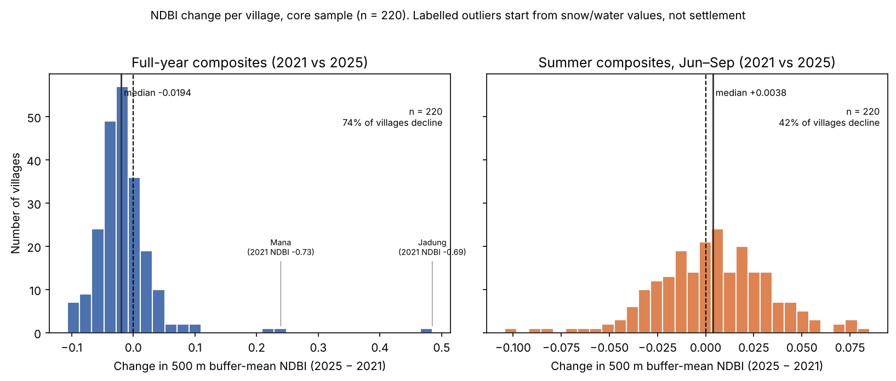

**Figure 2.** NDBI change per priority village, both windows. The two labelled full-year values start from snow or water.

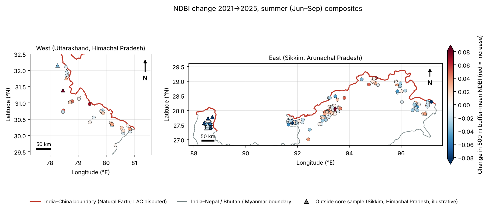

**Figure 3.** Summer NDBI change by village (red = increase). Triangles are villages outside the core sample; Sikkim's (left of the east panel) mostly decline.

### 5.2 Priority versus comparison villages

Table 2 and Figures 4–5 give the DiD estimates.

**Table 2.** Difference-in-differences, 2021→2025 (220 priority vs. up to 628 comparison villages in 13 districts, district-by-period fixed effects, district-clustered SE).

| Outcome | Window | δ | 95% CI (t, 12 df) | p (t, 12 df) | Wild bootstrap p |
|---|---|---|---|---|---|
| NDBI | Full year | +0.0067 | −0.0089, +0.0224 | 0.37 | 0.42 |
| NDBI | Summer | +0.0003 | −0.0063, +0.0070 | 0.92 | 0.92 |
| Night lights (nW/cm²/sr) | Full year | +0.053 | −0.061, +0.166 | 0.33 | 0.32 |
| Night lights | Summer | +0.035 | −0.061, +0.130 | 0.44 | 0.48 |
| Sentinel-1 VV (dB) | Full year | −0.003 | −0.061, +0.055 | 0.92 | — |
| Sentinel-1 VV (dB) | Summer | +0.012 | −0.048, +0.072 | 0.66 | — |
| Sentinel-1 VH (dB) | Full year | −0.005 | −0.077, +0.066 | 0.87 | — |
| Sentinel-1 VH (dB) | Summer | −0.008 | −0.099, +0.084 | 0.85 | — |
| Dynamic World built prob. | Full year | +0.0024 | −0.0002, +0.0051 | 0.067 | 0.072 |
| Dynamic World built prob. | Summer | +0.0050 | +0.0017, +0.0083 | 0.006 | 0.017 |

*Dynamic World: 218 treated / 626 comparison villages with valid full-year data; 169 / 486 in summer.*

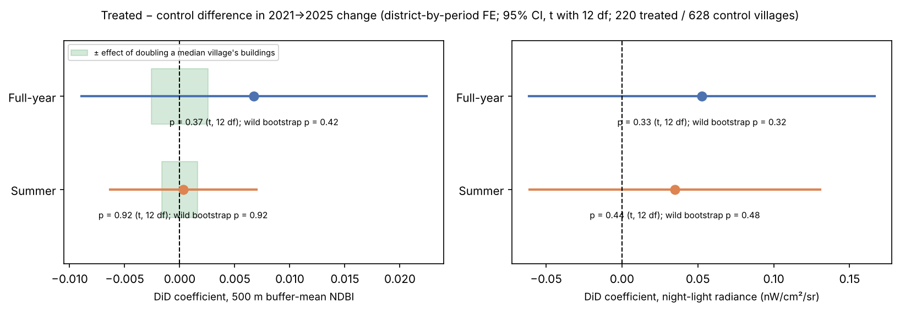

**Figure 4.** NDBI and night-light DiD estimates with 95% intervals. The green band marks the change in buffer-mean NDBI that doubling a median village's buildings would produce (Section 5.3).

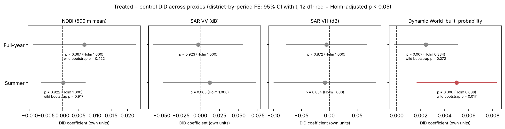

**Figure 5.** DiD estimates for all four measures, each on its own scale. Red marks an estimate that stays significant after the Holm correction within its family (Section 4.5).

NDBI, night lights and both radar polarisations show no priority–comparison difference in either window. Dynamic World's built probability rose more in priority villages in the summer window. This estimate is significant in all 12 leave-one-district-out re-estimations, and it stays significant after a Holm correction across the six triangulation tests (adjusted p = 0.038). The full-year estimate is smaller (+0.0024) and not significant (p = 0.067; bootstrap p = 0.072). It is significant in only 1 of 13 leave-one-district-out re-estimations, and on the villages that also have summer values it is +0.0013 (p = 0.22). In Version 2.0, which used the misplaced Sikkim comparison villages, the full-year estimate was significant (p = 0.031). It does not hold in the corrected sample. A 2019→2021 placebo for Dynamic World is null in both windows (p = 0.41 and 0.21), so the summer difference does not continue an earlier trend.

### 5.3 What the measures could detect

Buildings cover a median 0.32% of a 500 m buffer (90th percentile 2.5%), and 29 of the 220 priority buffers contain no mapped building at all. Table 3 converts this into detectability.

**Table 3.** Detectability of building change by each buffer-mean outcome.

| | NDBI full year | NDBI summer | Dynamic World full year | Dynamic World summer |
|---|---|---|---|---|
| Index change per unit building cover (SE) | 0.81 (0.25) | 0.50 (0.17) | 2.31 (0.19) | 2.10 (0.20) |
| Change from doubling the median village's buildings | +0.0026 | +0.0016 | +0.0074 | +0.0067 |
| …as a share of the DiD's minimum detectable effect | 12% | 17% | — | — |
| DiD estimate as building-equivalent area per village | +6,600 m² | +500 m² | +830 m² | +1,880 m² |
| 95% CI, building-equivalent area | −8,700 to +21,800 m² | −9,900 to +10,900 m² | −70 to +1,720 m² | +640 to +3,110 m² |
| Equivalence test vs. ± a doubling | not equivalent | not equivalent | equivalent (bounded effect) | not equivalent |

The NDBI design could not have detected even a doubling of a typical village's buildings. Its confidence intervals are compatible with anything from a loss of about four times to a gain of up to nine times a median village's building stock. The NDBI null is therefore uninformative about whether construction happened. Night lights face a related limit, because a VIIRS pixel is about the size of the buffer. Dynamic World responds three to four times more strongly to buildings than NDBI does. Its summer estimate corresponds to roughly 1,900 m² of built-up surface per priority village (95% CI about 600–3,100 m²), about three-quarters of a median village's footprint area. The full-year estimate, about 800 m², is not significant, and it is bounded below a doubling. The conversion assumes the cross-sectional relationship between building cover and index value also holds for change, and Dynamic World's "built" class also responds to roads and cleared ground, so the areas are indicative.

The measures also disagree with each other at village level. Dynamic World's change is almost unrelated to the change in NDBI or radar (Spearman ρ between −0.13 and +0.15), and the two point in the same direction in only 31–63% of villages. This suggests that they respond to different surfaces in the buffer.

### 5.4 Villages with documented new facilities

News reports of an official visit to Anjaw district on 31 October 2023 list new facilities in three sample villages: a civil terminal building and a girls' hostel at Walong, and basketball courts, solar streetlights, a school library and a school building at Kaho and Musai (Arunachal Times, 2023; ANI, 2023). The reports attribute these to the state's Golden Jubilee Model Village programme, which later merged with VVP. The only works they describe as funded under VVP are at Kibithoo, which is not in the sample because its geocoding failed. We treat the three villages as cases of documented new facilities. It is not confirmed that VVP funded any of these works.

Figure 6 places each village's change within the distribution of all 220 core villages. Night lights at Kaho and Walong were in the top 5% of all villages (95th and 98th percentiles), and Dynamic World at the 97th and 81st. Musai was close to the median on both (55th and 61st). NDBI at all three fell further than at most villages (9th–30th percentiles). This is consistent with lights responding to new lighting at two of the three sites, but three villages in one district cannot validate any measure.

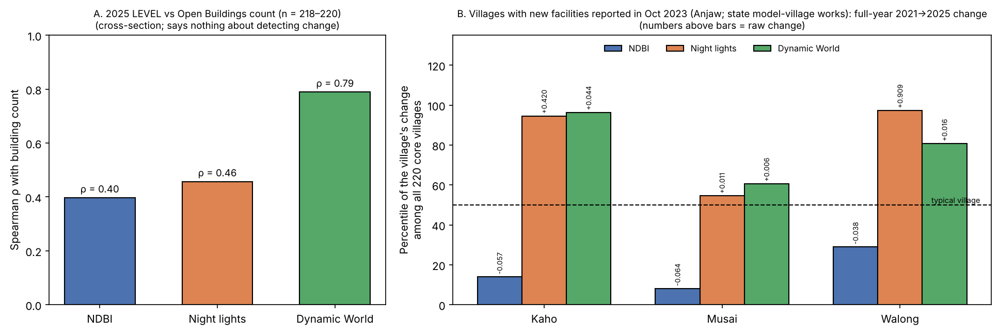

**Figure 6.** (A) Cross-sectional correlation between each measure's 2025 level and building count. (B) The three villages' 2021→2025 change as a percentile of all 220 core villages.

### 5.5 Border distance (SQ2)

Pooled across villages, summer NDBI change rises with distance from the boundary (ρ = +0.23, p = 5.4 × 10⁻⁴) and full-year night-light change falls with distance (ρ = −0.25, p = 1.5 × 10⁻⁴). Within districts, neither holds (Table 4, Figure 7). The summer NDBI association disappears (ρ = +0.01, p = 0.93), and the night-light association reverses: within districts, villages *farther* from the boundary gained more light, in both windows (ρ = +0.26, p = 0.015, and +0.45, p < 0.001). Using distance to the China boundary only gives the same pattern. So the pooled correlations come from differences between districts that lie at different distances from the boundary. Earlier versions of this paper treated them as robust, because they survived leave-one-district-out, randomization and spatial-autocorrelation checks. But none of those checks separates within-district from between-district variation. There is no consistent evidence that change concentrates near the boundary.

**Table 4.** Distance to boundary vs. change: pooled and within-district Spearman correlations.

| Outcome | Window | Pooled ρ (p) | Within-district ρ (permutation p) | Within-district ρ, China boundary only |
|---|---|---|---|---|
| NDBI | Full year | +0.06 (0.35) | −0.42 (< 0.001) | −0.44 (< 0.001) |
| NDBI | Summer | +0.23 (< 0.001) | +0.01 (0.93) | +0.01 (0.94) |
| Night lights | Full year | −0.25 (< 0.001) | +0.26 (0.015) | +0.25 (0.012) |
| Night lights | Summer | −0.11 (0.10) | +0.45 (< 0.001) | +0.44 (< 0.001) |

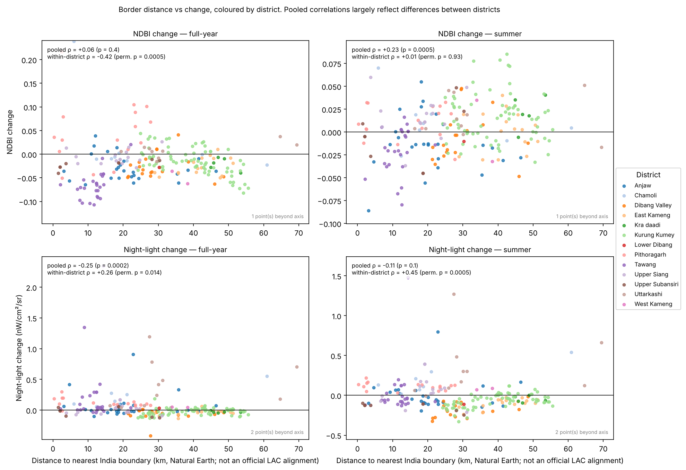

**Figure 7.** Distance to the nearest boundary vs. change, coloured by district, with pooled and within-district correlations.

## 6. Robustness

**Table 5.** Robustness of the primary DiD results (NDBI and night lights) and of the Dynamic World result.

| Check | Result |
|---|---|
| Placebo DiD, 2019→2021 | Null for full-year NDBI (p = 0.62), full-year lights (0.74), summer NDBI (+0.007, p = 0.17) and summer lights (0.66). Dynamic World null (0.41, 0.21). But the raw 2019→2021 summer NDBI changes of the two groups differ (Mann–Whitney p = 0.006), so parallel trends for summer NDBI are uncertain |
| 2021 baseline balance | NDBI balanced; night lights differ at baseline in both windows (p = 0.019 full year, 0.008 summer) |
| Leave one district out | NDBI and lights: 0 of 13 significant. Dynamic World: summer 12 of 12, full year 1 of 13 |
| Randomization inference (2,000 within-district permutations) | Summer NDBI p = 0.90, summer lights 0.24, full-year lights 0.20 |
| Without 82 comparison villages within 1 km of a treated village | All four primary DiDs null (p = 0.33–0.92) |
| Without 10 comparison villages that are qualifier-variant priority villages | No change (NDBI p = 0.38/0.95; lights 0.33/0.44; Dynamic World 0.063/0.007) |
| Without the 7 duplicated treated locations, 29 building-free treated buffers (and 60 comparison), and Joshimath | All primary DiDs null; Joshimath alone accounts for most of the mean summer light change (+0.032 with it, +0.005 without) |
| Full-year treated values from the project's Python pipeline instead of the Code Editor export | NDBI DiD +0.0052 (p = 0.40); lights unchanged (p = 0.33) |
| Buffer radius 250 m / 1 km (summer, same-day extraction) | Treated-only NDBI change: small increase at 250 m and 500 m (one-sided Wilcoxon p = 0.001 and 0.019), none at 1 km (0.22) |
| SCL cloud mask instead of QA60 | Treated-only summer NDBI change: small increase under both masks (one-sided Wilcoxon p = 0.019 QA60, 0.004 SCL) |
| Log night lights | Null (full year p = 0.31; summer 0.48) |
| Version 2.0 sample and specification (with the 93 Sikkim comparison villages, district intercepts only) | NDBI, lights and radar null. Dynamic World full year +0.0026 (p = 0.031), summer +0.0059 (p = 0.004). Without the 84 misplaced villages, full year +0.0017 (p = 0.19) |

*All DiD p-values use district-clustered standard errors and t with 12 degrees of freedom, except the Version 2.0 row (t with 13 df). Treated-only tests are not DiD estimates and only describe priority villages. The comparison villages changed by a similar amount (Table 2).*

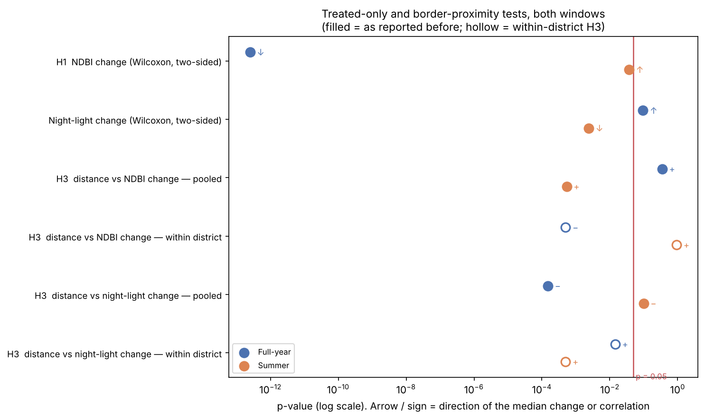

**Figure 8.** Treated-only and border-distance tests, both windows, including within-district versions.

The three-point trend (Figure 9) shows NDBI falling from 2021 to 2023 and recovering by 2025 in both windows. Sentinel-2's QA60 cloud band is not populated for most of 2022–2024 in the harmonized collection, so the 2023 composites may be effectively unmasked, and the dip should not be interpreted.

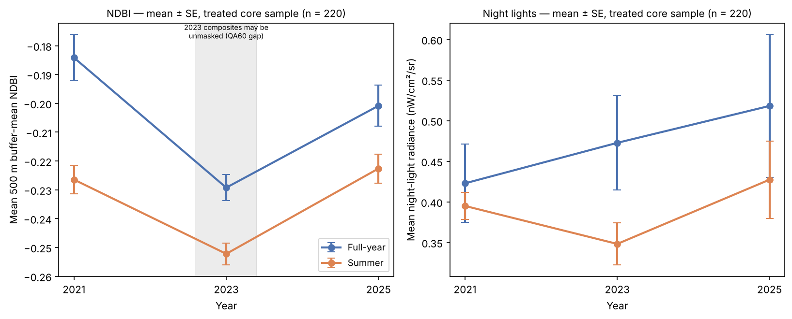

**Figure 9.** Mean NDBI and night lights in priority villages, 2021, 2023, 2025.

## 7. Discussion

Using the outcomes this study set out to use (buffer-mean NDBI and night lights), priority villages did not change differently from comparison villages between 2021 and 2025. But for NDBI that comparison could not have detected the scale of construction a village-level programme produces, so it does not show that nothing was built. The one measure that responds strongly to buildings, Dynamic World, does show a small positive difference in the summer window, equal to roughly 1,900 m² of built-up surface per village. The full-year estimate is smaller and not significant. Radar shows nothing, which may reflect its own low sensitivity at this scale as much as an absence of change.

There are several possible explanations for the Dynamic World result. The programme may have had a small early effect that the other measures are too coarse to pick up. The classifier may also be labelling other things as built, such as road widening, cleared construction sites, or the state model-village works that came before VVP. Finally, the result could be a false positive of the classifier. The placebo rules out a pre-existing trend, and the result survives small-cluster inference. Settlement-footprint outcomes and a 2026 follow-up (Section 8) are the most direct way to tell these apart.

The programme was approved in February 2023 and launched in April 2023, and the documented new facilities in the sample date from late 2023. A 2025 endpoint captures at most about two years of possible works, and nothing in the public record shows how many works were complete by then. The estimate is the effect of priority *designation* after about two years. It is not the effect of completed works.

For the securitization question, the evidence is negative but weak. The pooled association with border distance came from differences between districts, and within districts night lights grew more in villages farther from the boundary. No consistent pattern supports prioritisation of the villages closest to the border.

Other studies that average a satellite index over a buffer may have the same problem. Here, buildings covered only about 0.32% of a typical buffer, so even a doubling of a village's buildings could not move buffer-mean NDBI enough to be detected. Checking this before reading the null result changed how the main result of this study should be read.

### Implications for programme monitoring and evaluation

The results have practical lessons for monitoring VVP-I and similar programmes.

- The choice of indicator decides what an evaluation can find. A buffer-mean NDBI could not show even a doubling of a village's buildings, while Dynamic World, which responds more strongly to buildings, could show a small change. A monitoring system should check what an indicator can detect before relying on it.
- Public village lists made this study possible. Lists for Himachal Pradesh and Ladakh, and a list of sanctioned and completed works for each village, would allow a direct test of whether completed works changed villages. A government's analytical capacity, including the data it collects and publishes, shapes how a policy can be designed and adjusted (Fabris, Daugbjerg, & Hansen, 2026).
- Priority villages were named in advance, so non-priority villages in the same districts already form a comparison group that a regular evaluation of the programme could use.

### Limitations

- **Treatment definition.** Priority designation is observed; completed works are not. Comparison villages may include non-priority VVP-I villages, which would bias estimates toward zero.
- **Geocoding.** Only 220 of the 506 listed villages in Arunachal Pradesh and Uttarakhand are in the core sample, and geocoding success varies strongly by district (Arunachal Pradesh χ² = 139, p = 6 × 10⁻²⁵; Tawang 17%, Shiyomi 0%). Within Arunachal Pradesh, geocoded villages do not differ in population (p = 0.31). Positional accuracy has not been verified: 74 core villages were located by a fallback query without block information, 29 buffers contain no mapped building, 7 pairs of villages share coordinates, and Kibithoo could not be located.
- **Measurement.** Buffer means dilute village-scale change (Section 5.3). Full-year composites include snow. The 2023 composites may be unmasked. VIIRS pixels are about the size of the buffer.
- **Comparison villages.** Comparison villages were taken closest to the border first, not at random, and selection depended on OpenStreetMap at the time, which will have changed. A random draw has not yet been tested.
- **Inference.** There are 13 district clusters; small-cluster methods are used throughout, but power for district-level confounding is limited. Priority status was assigned by administrators, so unobserved selection factors may remain. Night lights differ between the groups at baseline, and parallel trends for summer NDBI are uncertain (Table 5). Spatial autocorrelation among villages is present (summer NDBI change: Moran's I = 0.31, p = 0.001).
- **Coverage.** Himachal Pradesh and Ladakh are not analysed, because no name-level lists are public. Sikkim is not analysed, because no comparison villages could be verified inside its North district.
- **Boundaries.** Distances use Natural Earth cartographic lines; the Line of Actual Control is disputed, and distances are comparative only.

## 8. Next steps

The following analyses are prepared in the repository (`docs/NEXT_STEPS_EARTH_ENGINE.md`) and require a live Earth Engine session or manual work:

1. **Settlement-targeted outcomes.** NDBI and Dynamic World inside each village's Open Buildings footprint zone, Dynamic World built-up area in square metres, Cloud Score+ masking and cloud-filtered VIIRS, for 2019, 2021, 2025 and summer 2026 (`extract_settlement_masked.py`, `settlement_masked_did.py`).
2. **Same-day re-extraction** of full-year values for treated and comparison villages with the repository's own script, so that the two NDBI extractions (Section 3.3) can be replaced by one.
3. **Sikkim comparison villages** rebuilt inside a verified North Sikkim boundary (for example from Census or Local Government Directory village points) and re-extracted, so that Sikkim can rejoin the analysis.
4. **Geocode review** of every point against high-resolution imagery, including the 29 building-free buffers, the duplicated locations, Joshimath and Kibithoo.
5. **Works data** for a subset of priority villages, to estimate effects where works are known to be complete, and a check of comparison villages against the VVP-I block list.

Two further extensions are not yet prepared. The first would measure the environmental side of the programme: forest loss, slope disturbance and landslide exposure around priority villages and new roads, with the same difference-in-differences and detectability checks. The second would apply the same satellite measures to China's Xiaokang villages across the boundary, if their locations can be compiled from public sources. This would allow a direct comparison of how the two programmes change border settlements.

## Declarations

### Author contributions

Sakshi D. Maske: Conceptualization, Methodology, Software, Validation, Formal analysis, Investigation, Data curation, Writing – original draft, Writing – review and editing, Visualization. This is a single-author study.

### Funding

This research received no external funding. I covered all costs myself.

### Competing interests

I declare no competing interests. I have no connection with the Vibrant Villages Programme or with any body that runs or evaluates it.

### Ethics approval

Not applicable. The study uses public village lists and satellite data at village level. It did not involve human participants, animals or personal data.

### Data availability

All data are from public sources (Section 3). The village lists come from Ministry of Home Affairs replies to Parliament, the Arunachal Pradesh list of identified villages, and a secondary Uttarakhand list matched to official counts. Village coordinates come from OpenStreetMap Nominatim and ISRO Bhuvan, and the comparison villages come from OpenStreetMap (© OpenStreetMap contributors, ODbL). Sentinel-2, Sentinel-1, VIIRS night lights, Dynamic World and Google Open Buildings were accessed through Google Earth Engine. The paper contains modified Copernicus Sentinel data (2019–2025). Dynamic World and Open Buildings are released by Google under CC BY 4.0 (Open Buildings also under ODbL). Boundary lines are from Natural Earth and are cartographic only. All processed data used in the analysis are stored in the repository.

### Code availability and reproducibility

The code that geocodes the villages, selects the comparison villages, extracts the satellite data and produces every estimate, table and figure in this paper is available at github.com/sakshimaske303-commits/BORDER_OPTICS. The dashboard and the statistical scripts run from the files in the repository. Only the extraction scripts need a Google Earth Engine account. `docs/ANALYSIS_FREEZE.md` records the data and code state behind this version, and `tests/test_data_integrity.py` checks 16 data invariants that the results depend on, including that every comparison village lies in a verified district. The primary difference-in-differences is coded twice, in statsmodels and in NumPy, and the two give the same estimates. The full-year NDBI and night-light values of the treated villages come from an earlier Code Editor export whose script was not kept (Section 3.3).

### Corrections and version history

The results changed several times as I found and corrected errors. Each change is recorded in `docs/BO_Development_Log.md` and summarised in `docs/BO_Results_Stability_Table.md`. In brief:

- an early significant summer NDBI increase disappeared when an incomplete extraction, which had returned no summer scenes for any Sikkim village, was redone;
- a significant full-year night-light DiD disappeared when 23 comparison villages that duplicated priority villages were removed;
- an apparent disagreement between cloud masks was a coding error (snow counted as clear).

The cause of the original Sikkim gap is not established; a check is prepared (`check_s2_archive_ingestion.py`).

Version 2.0 followed an independent review (Development Log Entry 49). The main changes were:

- the primary analysis became the DiD rather than the treated-only change;
- it added the detectability analysis, small-cluster inference for Dynamic World, and the within-district border-distance analysis, which reverses the earlier interpretation of the border correlations;
- it corrected the attribution of the Anjaw facilities;
- it added the sample-quality sensitivity checks.

Version 2.1 followed a second review of the code and data (November 2026). It found two problems, and both are corrected here:

- 84 of the 93 comparison villages for Sikkim's North district lay outside that district, many of them in Nepal, Bhutan or West Bengal, because the selection code had fallen back to a bounding box (Section 3.2). Sikkim is now outside the core sample, and the sample is 220 priority and 628 comparison villages in 13 districts;
- the district fixed effects did not make the DiD a within-district comparison, because with two periods they cancel out. The model now has district-by-period effects (Section 4.1).

With both corrections, NDBI, night lights and radar remain null, and the summer Dynamic World estimate remains significant (+0.0050, p = 0.006). The full-year Dynamic World estimate, significant in Version 2.0, is no longer significant (+0.0024, p = 0.067). The budget comparison across states was dropped, because only two states remain. Table 5 gives the Version 2.0 estimates for comparison.

### Use of AI tools

The research design, the choice of primary and secondary analyses and the interpretation of the results are my own. I used Claude (Anthropic), an AI assistant, in a supporting role throughout the project. Its main use was to check that the estimates reported in the paper, executive summary, README, results stability table and dashboard remained consistent with the analysis outputs after each round of corrections. I also consulted it when a script failed or produced output I could not explain, and for the layout of the project pages. After the independent review of version 2.0, I used it to re-run the analysis scripts, to verify the documents and dashboard against the outputs, and to draft the script for the Holm correction (Development Log Entry 50). I also used it to suggest corrections and clearer wording for parts of this paper and to structure these declarations. I reviewed every suggestion before using it. The assistant was not used to geocode villages, select comparison villages, extract satellite data, design the statistical models or decide which results to report. I take full responsibility for the content of this paper.

### Licence and citation

The code, documentation and paper are released under the Creative Commons Attribution 4.0 International licence (CC BY 4.0). Files derived from OpenStreetMap remain under the Open Database Licence. Citation metadata are in `CITATION.cff`.

## References

ANI. (2023, October 31). Arunachal DyCM Chowna Mein inaugurates 15 projects in Anjaw villages. https://aninews.in/news/national/general-news/arunachal-dycm-chowna-mein-inaugurates-15-projects-in-anjaw-villages20231031233238/

Arunachal Times. (2023, November 1). DCM inaugurates several projects in Anjaw. https://archive.arunachaltimes.in/index.php/2023/11/01/dcm-inaugurates-several-projects-in-anjaw/

Arvanitopoulos, T., Bulian, S., Wilson, C., Jordan, A. J., Tosun, J., & Vasilakos, N. (2026). Climate policy portfolios that accelerate emission reductions. *Nature Communications*, 17, 1989. https://doi.org/10.1038/s41467-026-68577-z

Brown, C. F., Brumby, S. P., Guzder-Williams, B., et al. (2022). Dynamic World, near real-time global 10 m land use land cover mapping. *Scientific Data*, 9, 251. https://doi.org/10.1038/s41597-022-01307-4

Buzan, B., Wæver, O., & de Wilde, J. (1998). *Security: A New Framework for Analysis*. Lynne Rienner.

Cairney, P. (2016). *The Politics of Evidence-Based Policy Making*. Palgrave Macmillan.

Cameron, A. C., Gelbach, J. B., & Miller, D. L. (2008). Bootstrap-based improvements for inference with clustered errors. *Review of Economics and Statistics*, 90(3), 414–427. https://doi.org/10.1162/rest.90.3.414

Cameron, A. C., & Miller, D. L. (2015). A practitioner's guide to cluster-robust inference. *Journal of Human Resources*, 50(2), 317–372. https://doi.org/10.3368/jhr.50.2.317

Donaldson, D., & Storeygard, A. (2016). The view from above: Applications of satellite data in economics. *Journal of Economic Perspectives*, 30(4), 171–198. https://doi.org/10.1257/jep.30.4.171

Elvidge, C. D., Baugh, K., Zhizhin, M., Hsu, F. C., & Ghosh, T. (2017). VIIRS night-time lights. *International Journal of Remote Sensing*, 38(21), 5860–5879. https://doi.org/10.1080/01431161.2017.1342050

Fabris, L., Daugbjerg, C., & Hansen, T. (2026). The role of policy capacity in energy transitions: The case of the Brazilian wind energy sector. *Journal of Environmental Policy & Planning*, 28(5), 864–883. https://doi.org/10.1080/1523908X.2026.2628710

Kumar, A. (2024, July 19). The Vibrant Villages Programme: A response to PLA's salami slicing through Xiaokang villages. Observer Research Foundation. https://www.orfonline.org/expert-speak/the-vibrant-villages-programme-a-response-to-pla-s-salami-slicing-through-xiaokang-villages

Lakens, D. (2017). Equivalence tests: A practical primer for t tests, correlations, and meta-analyses. *Social Psychological and Personality Science*, 8(4), 355–362. https://doi.org/10.1177/1948550617697177

Ministry of Home Affairs. (2023a, August 9). *Rajya Sabha Unstarred Question No. 2321: Vibrant Villages Programme*. https://www.mha.gov.in/MHA1/Par2017/pdfs/par2023-pdfs/RS09082023/2321.pdf

Ministry of Home Affairs. (2023b, March 29). *Rajya Sabha Question No. 3251: Vibrant Villages Programme*. https://www.mha.gov.in/MHA1/Par2017/pdfs/par2023-pdfs/RS29032023/3251.pdf

Ministry of Home Affairs. (2023c, March 14). *Lok Sabha Question No. 2104: Vibrant Villages Programme*. https://www.mha.gov.in/MHA1/Par2017/pdfs/par2023-pdfs/LS14032023/2104.pdf

Ministry of Home Affairs. (2025). *Lok Sabha Question No. 4360: Vibrant Villages Programme*. https://sansad.in/ls/questions/questions-and-answers

Ministry of Home Affairs. (2026, February 3). *Lok Sabha Unstarred Question No. 508: Vibrant Villages Programme*. https://www.mha.gov.in/MHA1/Par2017/pdfs/par2026-pdfs/LS03022026/508.pdf

Neumark, D., & Simpson, H. (2015). Place-based policies. In G. Duranton, J. V. Henderson, & W. C. Strange (Eds.), *Handbook of Regional and Urban Economics* (Vol. 5, pp. 1197–1287). Elsevier.

Natural Earth. (2024). *1:10m Cultural Vectors, Admin 0 Boundary Lines*. https://www.naturalearthdata.com/

OpenStreetMap contributors. (2024). OpenStreetMap data via Nominatim and the Overpass API. Data © OpenStreetMap contributors, ODbL. https://www.openstreetmap.org/copyright

Sirko, W., Kashubin, S., Ritter, M., et al. (2021). Continental-scale building detection from high resolution satellite imagery. arXiv:2107.12283. https://arxiv.org/abs/2107.12283

Outlook India. (2023, April). Shah to visit Arunachal village along China border to launch the Vibrant Villages Programme. https://www.outlookindia.com/national/shah-to-visit-arunachal-village-along-china-border-to-launch-the-vibrant-villages-programme-news-277237

Spearman, C. (1904). The proof and measurement of association between two things. *American Journal of Psychology*, 15(1), 72–101.

Wilcoxon, F. (1945). Individual comparisons by ranking methods. *Biometrics Bulletin*, 1(6), 80–83.

Zha, Y., Gao, J., & Ni, S. (2003). Use of normalized difference built-up index in automatically mapping urban areas from TM imagery. *International Journal of Remote Sensing*, 24(3), 583–594. https://doi.org/10.1080/01431160304987

## Appendix

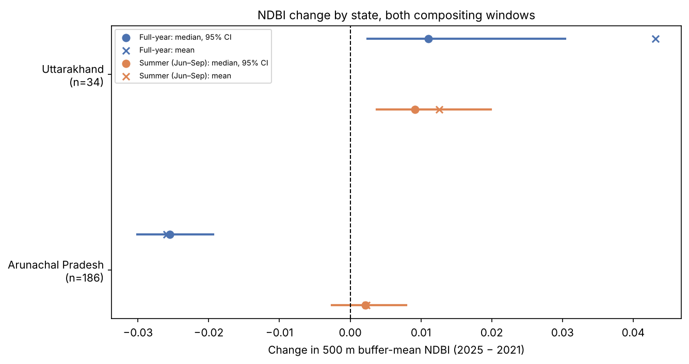

**Figure A1.** NDBI change by state, core sample: medians with 95% bootstrap intervals and means.

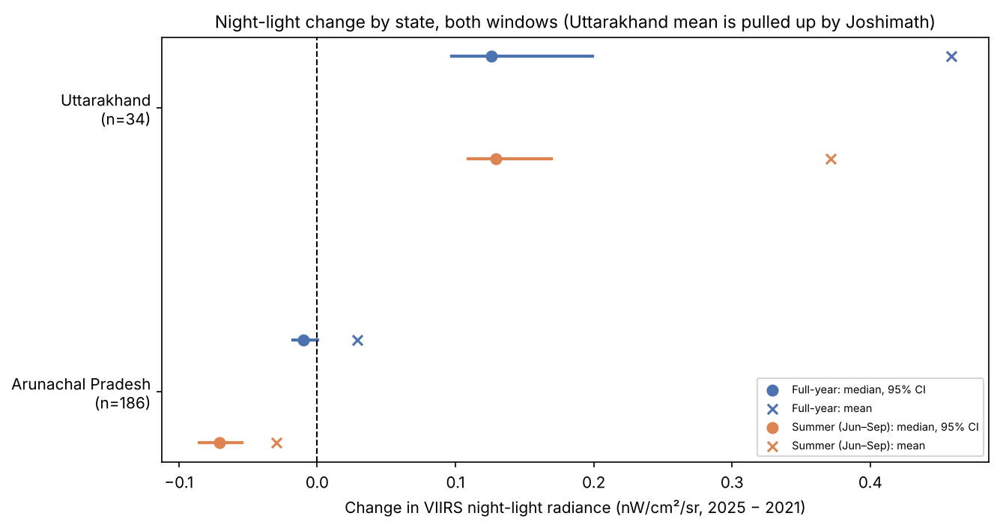

**Figure A2.** Night-light change by state, core sample.

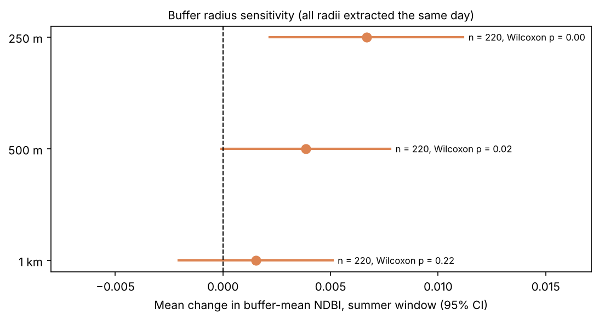

**Figure A3.** Treated-only NDBI change at three buffer radii (summer window).

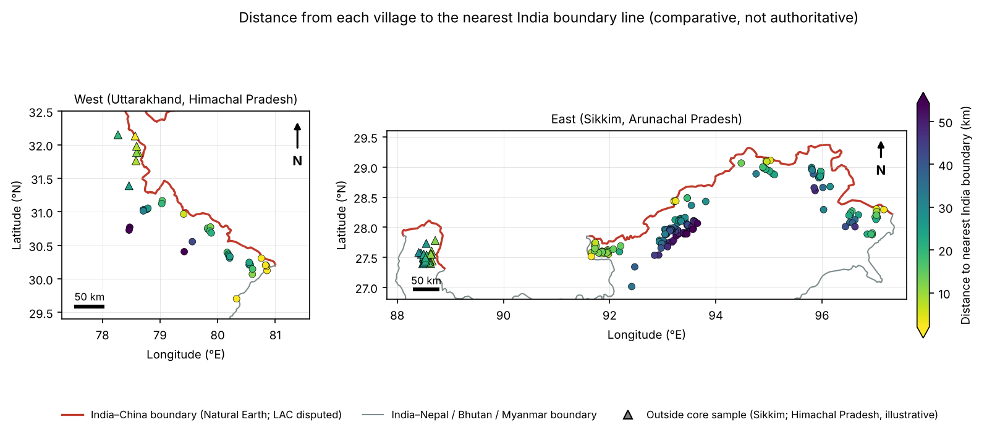

**Figure A4.** Distance from each village to the nearest India boundary line.
